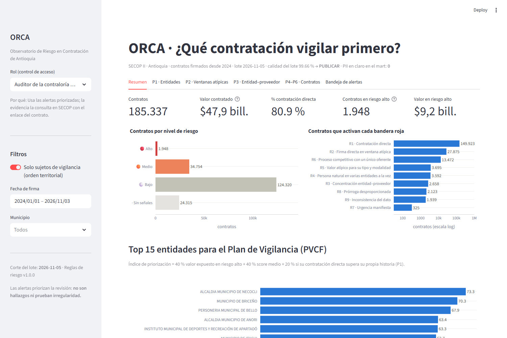
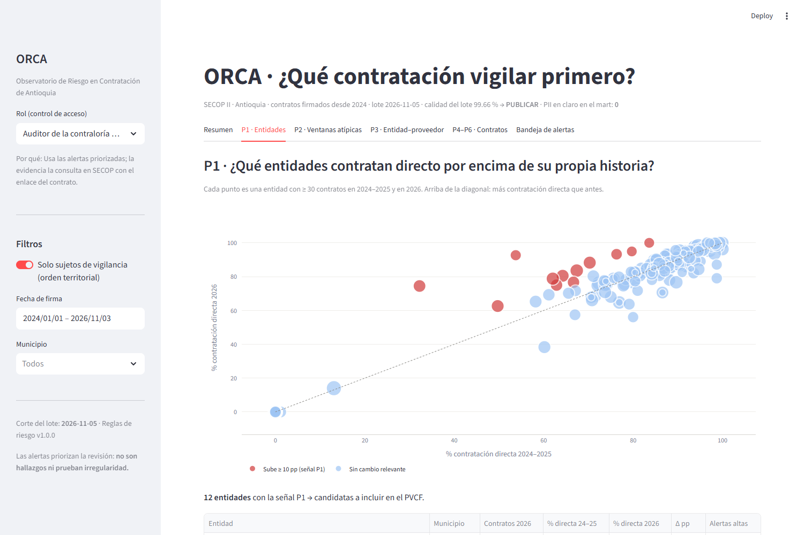
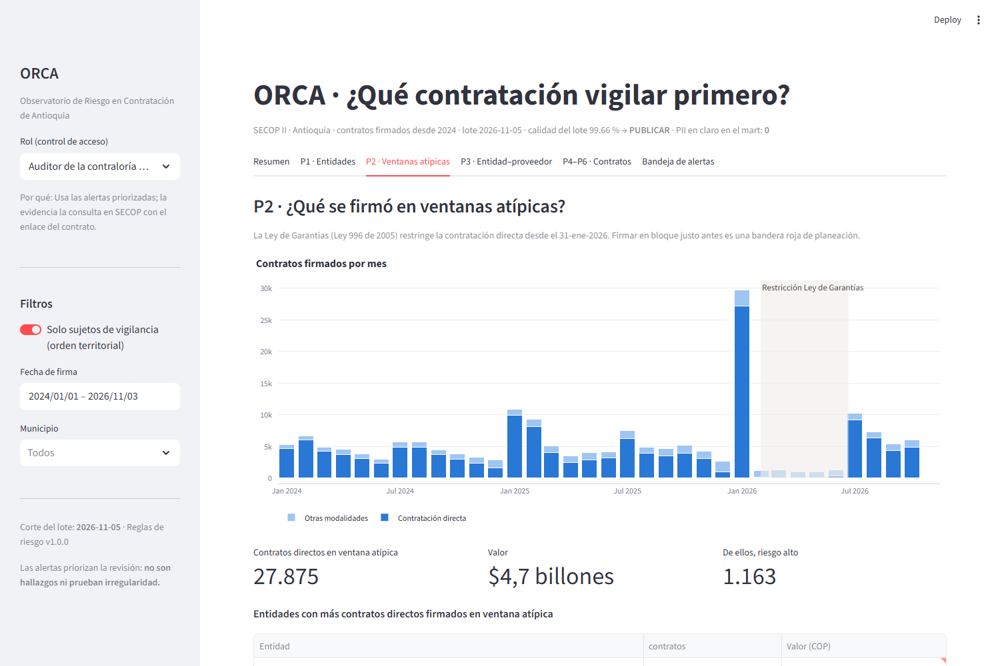
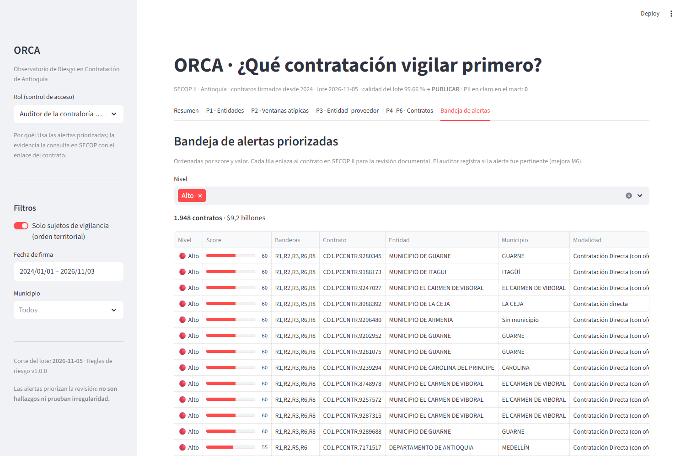
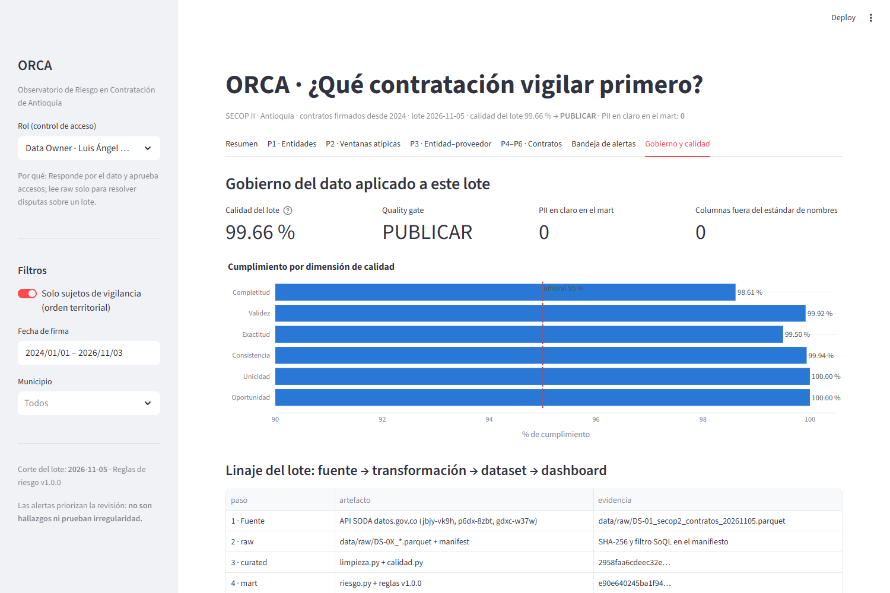
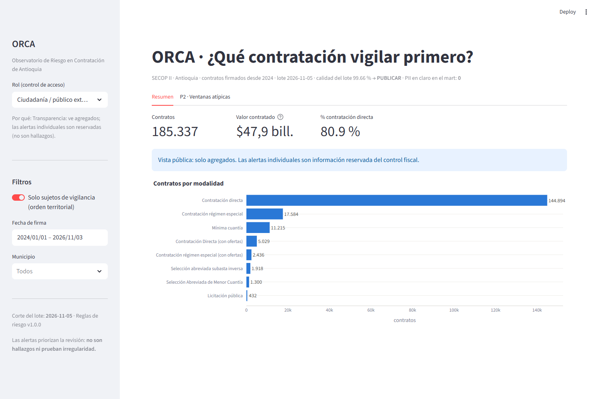

# Dashboard ORCA · v1.0 (entrega final)

Tablero de **priorización de la vigilancia fiscal**: responde las preguntas de negocio P1–P6 de [01_estrategia_y_organizacion.md](../documentacion/01_estrategia_y_organizacion.md) §3 y entrega al auditor una bandeja de alertas con enlace a SECOP II.

```bash
# desde la raíz del repositorio, con la zona mart generada
streamlit run dashboard/app.py
```

## Qué decisión habilita cada pestaña

| Pestaña | Pregunta | Decisión |
|---|---|---|
| **Resumen** | ¿Cuánto riesgo hay y dónde? | Top 15 de entidades para el **Plan de Vigilancia (PVCF)** según el índice de priorización |
| **P1 · Entidades** | ¿Qué entidades contratan directo por encima de su propia historia? | Incluir la entidad en el PVCF |
| **P2 · Ventanas atípicas** | ¿Qué se firmó justo antes de la Ley de Garantías o al cierre de la vigencia? | Priorizar la revisión documental |
| **P3 · Entidad–proveedor** | ¿Qué proveedores concentran contratos o valor en una entidad? | Auditoría de cumplimiento al par |
| **P4–P6 · Contratos** | Personas naturales en varias entidades a la vez · valores atípicos · único oferente | Verificar la capacidad de ejecución · revisar los estudios de mercado · alerta temprana |
| **Bandeja de alertas** | ¿Qué reviso hoy? | Contratos ordenados por score, con enlace a SECOP y descarga CSV |
| **Gobierno y calidad** | ¿Puedo confiar en este dato? | Calidad del lote, quality gate, PII en claro = 0, linaje y matriz de acceso |

## Gobierno aplicado en el dashboard

- **Solo lee la zona `mart`** (sin PII en claro). Nunca abre `raw` ni `curated`.
- **Control de acceso por rol:** el selector de la barra lateral simula la autenticación. La ruta del mart se obtiene con `gobierno.ruta_capa(rol, "mart")`, que lanza `AccesoDenegado` si el rol no tiene permiso. Cada rol ve solo las pestañas que le autoriza la matriz del Plan de Gobierno §8. La **ciudadanía** ve solo agregados: las alertas individuales son reservadas porque no son hallazgos.
- Las personas naturales aparecen **solo por seudónimo** (HMAC-SHA256); las personas jurídicas, con su nombre público.
- El encabezado muestra siempre el corte del lote, el puntaje de calidad, la decisión del gate y la versión de las reglas de riesgo.

## Capturas

| | |
|---|---|
|  |  |
|  |  |
|  |  |

Las capturas se regeneran con `python dashboard/capturar_pantallas.py` (Playwright + Edge).

`eda/` conserva las figuras del EDA inicial (Entrega 2).
