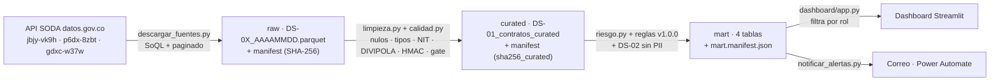

# 05 · Plan de Gobierno de Datos

| | |
|---|---|
| **Solución** | ORCA — Observatorio de Riesgo en Contratación de Antioquia |
| **Versión** | **1.0 · entrega final (13-nov-2026)** · lote de evidencia: corte 5-nov-2026. Historial: v0.1 madurez, roles y RACI (9-oct) · v0.2 catálogo, diccionario y glosario (19-oct) · v1.0 políticas, calidad medida, clasificación, acceso, linaje y madurez al cierre |
| **Asignatura** | Data Office Strategy · UPB · Docente: María Victoria Valencia Arango |
| **Plantillas diligenciadas** | Sesión 1: [plan_gobierno/ORCA-Plantilla-RACI-v1.0.xlsx](plan_gobierno/ORCA-Plantilla-RACI-v1.0.xlsx) (madurez, roles y RACI) · Sesión 2: [plan_gobierno/S2_Metadatos_EquipoORCA.xlsx](plan_gobierno/S2_Metadatos_EquipoORCA.xlsx) (ficha, diccionario, glosario y autoevaluación) |
| **Evidencia ejecutable** | [`notebooks/04_gobierno_datos.ipynb`](../notebooks/04_gobierno_datos.ipynb) (aplica y verifica los 8 artefactos) · [`notebooks/gobierno.py`](../notebooks/gobierno.py) (políticas como código) · salidas en [`gobierno/`](gobierno/) |
| **Marco de referencia** | DAMA-DMBOK 2.ª ed. y Ley 1581 de 2012 / Decreto 1377 de 2013 (§10) · Ley 1712 de 2014 |
| **Activos gobernados** | DS-01 SECOP II Contratos (`jbjy-vk9h`) · DS-02 SECOP II Procesos (`p6dx-8zbt`) · DS-03 DIVIPOLA (`gdxc-w37w`) y sus capas derivadas *raw* → *curated* → *mart* |

> **Cómo leer este plan.** Cada artefacto obligatorio tiene aquí su definición (lo que decidimos) y su **evidencia** sobre el lote real (lo que demuestra que se aplica). La regla del equipo fue: *si no se puede verificar con código, no cuenta como implementado*.
>
> | Artefacto obligatorio | Sección | Evidencia que lo demuestra |
> |---|---|---|
> | Catálogo / inventario de activos | §4.1 y §4.6 | `gobierno/catalogo_activos.csv` (se genera desde los manifiestos del pipeline) |
> | Diccionario de datos | §4.3 y §4.7 | Excel S2 (20 columnas de la fuente) · `gobierno/diccionario_mart.csv` (39 columnas del mart, con cumplimiento medido) |
> | Roles y responsabilidades (RACI) | §2–3 | Plantilla S1 · `gobierno/raci_proyecto.csv` (regla de oro verificada en el notebook) |
> | Políticas y estándares | §5 | Nomenclatura validada (0 columnas fuera del estándar) · retención ejecutada por el orquestador |
> | Reglas de calidad | §6 | 14 reglas por lote (quality gate 99,66 % → PUBLICAR) + 7 reglas del mart |
> | Linaje y trazabilidad | §7 | `gobierno/linaje.csv` · cadena de SHA-256 verificada de la fuente al dashboard |
> | Clasificación y sensibilidad | §8 | `gobierno/clasificacion_campos_DS-01.csv` (95 campos: 21 con datos personales y 4 de texto libre que pueden contenerlos) · PII en claro = 0 |
> | Control de acceso | §9 | `gobierno/matriz_acceso.csv` · `gobierno.ruta_capa()` probado para 6 roles × 4 capas |
>
>
> **Relación con [01 §6](01_estrategia_y_organizacion.md#6-diseño-organizacional-del-data-office):** el documento 01 diseña el Data Office **de la contraloría** (10 roles, RACI organizacional). Aquí se aplica el modelo **al proyecto**: los 4 roles de gobierno que exige la práctica, asignados a los 4 integrantes, sobre los 3 datasets. La equivalencia entre ambos está en el §2.2.

---

## 1. Diagnóstico de madurez

### 1.1 Instrumento (Sí = 2 · Parcial = 1 · No = 0)

Se puntúan **tres momentos** para que la reflexión tenga una línea base y una meta, no solo una foto:

- **AS-IS:** la contraloría antes de ORCA (proceso descrito en el [BPMN AS-IS](03_procesos_bpmn.md)).
- **Hoy:** ORCA al 9-oct-2026, con lo construido en la Entrega 1.
- **Meta:** lo que ORCA debe tener al cierre del proyecto (13-nov-2026).

| # | Afirmación | AS-IS | Hoy | Meta | Evidencia de "Hoy" |
|---|---|:-:|:-:|:-:|---|
| 1 | Sabemos quién es el responsable (dueño) de nuestros datos. | 0 | **1** | 1 | Roles definidos en [01 §6.4](01_estrategia_y_organizacion.md) y asignados en el §2 de este documento, pero todavía no hay un Owner registrado **por activo** en un catálogo. En la meta queda en *Parcial* a propósito: el Data Owner real (un Contralor Auxiliar) es simulado por el equipo. |
| 2 | Tenemos un inventario o catálogo de los datos que usamos. | 0 | **1** | 2 | Los 3 datasets están identificados (DS-01…03) con su ID, licencia y rol ([02 §3](02_seleccion_datos_abiertos.md)), pero no existe un catálogo formal con dueño, clasificación y frecuencia por activo. |
| 3 | Cada campo está definido (existe un diccionario de datos). | 1 | **1** | 1 | Los 95 campos de DS-01 están agrupados por tema ([02 §5](02_seleccion_datos_abiertos.md)) y datos.gov.co publica descripciones de columna, pero no hay un diccionario propio con tipo, dominio, regla de calidad y sensibilidad por campo. En la meta queda *Parcial* por decisión de alcance: se definen a fondo los campos que el pipeline conserva y usa, no todos los de la fuente. |
| 4 | Medimos la calidad del dato (nulos, duplicados, errores). | 0 | **1** | 2 | Hallazgos medidos una vez en el notebook ([02 §7](02_seleccion_datos_abiertos.md): 40.638 fechas nulas, 2.848 valores en $0, nulos disfrazados…). Aún no son reglas que se ejecuten en cada lote con umbral. |
| 5 | Clasificamos qué datos son sensibles o personales. | 0 | **1** | 2 | Clasificación preliminar de 9 campos PII y de las capas (*raw* Confidencial, *curated* Interno, *mart* Confidencial) en [02 §6](02_seleccion_datos_abiertos.md). Falta formalizarla y que la apruebe el Owner. |
| 6 | Está claro quién puede ver o modificar cada dato. | 0 | **1** | 1 | *raw* excluido del repositorio por `.gitignore` y clasificación por capa, pero no hay matriz de acceso por rol. En la meta queda *Parcial*: sin infraestructura institucional, el control de acceso se documenta y se simula, no se impone con IAM. |
| 7 | Podemos rastrear de dónde viene cada dato (linaje). | 0 | **1** | 2 | [`notebooks/descargar_fuentes.py`](../notebooks/descargar_fuentes.py) deja un `*.manifest.json` por lote (consulta SoQL, filas, SHA-256, fecha de corte). El linaje cubre solo *raw*; falta llevarlo a *curated* y *mart*. |
| 8 | Tenemos políticas o estándares escritos sobre el dato. | 1 | **1** | 2 | Principios del Data Office ([01 §5.5](01_estrategia_y_organizacion.md)) y decisiones preliminares sobre PII. No hay todavía políticas aprobadas. En el AS-IS cuenta como *Parcial* porque la entidad tiene la política de tratamiento de datos personales que exige la Ley 1581, aunque no aplica al uso analítico del SECOP. |
| | **TOTAL** | **2 / 16** | **8 / 16** | **13 / 16** | |
| | **Nivel de madurez** | **1 · Inicial** | **3 · Definido** | **4 · Gestionado** | |

Escala: 0–3 Inicial · 4–6 Repetible · 7–10 Definido · 11–13 Gestionado · 14–16 Optimizado.

### 1.2 Reflexión

**¿En qué nivel estamos hoy?** La contraloría del caso parte del **Nivel 1 · Inicial (2/16)**: nadie es dueño del dato, las extracciones son manuales y la PII circula en archivos de Excel. Con la Entrega 1, ORCA suma **8/16**, que en la escala cae en **Nivel 3 · Definido**. El puntaje hay que leerlo con cuidado: **las ocho respuestas son "Parcial"**. Todo está *pensado y documentado*, pero nada está *operando* todavía. Siendo estrictos, estamos en la frontera entre el Nivel 2 y el 3: tenemos la definición, no la práctica repetible.

**¿A dónde queremos llegar?** A **Nivel 4 · Gestionado (13/16)** el 13-nov-2026: gobierno que no solo está escrito, sino que **se mide en cada lote** (score de calidad, PII en claro = 0, linaje por lote) y tiene dueños con nombre. No apuntamos al Nivel 5 porque *optimizado* exige mejora continua demostrada en el tiempo (varios ciclos de recalibración con datos de uso real), algo que un proyecto de siete semanas no puede mostrar con honestidad. Las tres preguntas que quedan en *Parcial* en la meta lo están por razones explícitas: dos por el entorno académico (1: el Owner real es simulado; 6: no hay IAM institucional) y una por alcance (3: el diccionario cubre los campos que se usan).

> **Coherencia con [01 §6.8](01_estrategia_y_organizacion.md):** allí la meta es Nivel 3 para la **organización** (la contraloría operando el Data Office de forma sostenida). Aquí se mide el gobierno **del activo** que construye el proyecto, sobre un alcance acotado (3 datasets), donde sí es alcanzable el Nivel 4.

**¿Qué nos falta para dar el salto?** Cada pregunta en *Parcial* se convierte en un artefacto con fecha y responsable:

| # | Brecha | Artefacto que la cierra | Responsable (A) | Fecha |
|---|---|---|---|---|
| 2, 3 | No hay catálogo ni diccionario | Catálogo de activos y diccionario de datos de DS-01…03, con todos los campos que conserva el pipeline (Sesión 2) | Data Steward | 23-oct |
| 4 | Calidad medida una sola vez | Reglas de calidad en 6 dimensiones, ejecutadas por lote, con *quality gate* ≥ 95 % | Data Steward | 23-oct |
| 5 | Clasificación preliminar | Matriz de clasificación por campo + política de seudonimización (hash con sal) aprobada | Data Owner | 23-oct |
| 7 | Linaje solo en *raw* | Manifiesto de linaje en *curated* y *mart* (lote de origen → transformación → salida) | Custodio técnico | 23-oct |
| 8 | Sin políticas aprobadas | Políticas de calidad, privacidad, acceso y retención en el Plan de Gobierno | Data Owner | 23-oct (borrador) / 13-nov (aprobado) |
| 1, 6 | Owner sin registro por activo; acceso sin matriz | Owner y Steward en cada fila del catálogo + matriz de acceso por capa y rol | Data Owner | 13-nov |

---

## 2. Roles del Data Office en el equipo

### 2.1 Asignación

| Rol de gobierno | Qué hace en ORCA | Integrante | Por qué esta persona |
|---|---|---|---|
| **Data Owner** (dueño) | Decide alcance, reglas de calidad, clasificación y acceso; aprueba lo que se publica en el dashboard. | **Luis Ángel Seoanes Ovieso** | Es CDO y Product Owner del proyecto: ya responde por las prioridades y por la integración de los entregables. |
| **Data Steward** (custodio de negocio) | Define el significado de cada campo, mantiene catálogo y diccionario, mide la calidad y resuelve sus incidentes. | **Julian Amariles Taborda** | Lidera el Plan de Gobierno y las reglas de calidad ([01 §6.7](01_estrategia_y_organizacion.md)). |
| **Custodio técnico** | Implementa y opera la ingesta, la limpieza, la seudonimización, el linaje y la automatización. | **Katheryn Ramírez Chimá** | Ingeniera de datos: lidera el pipeline Python y la automatización. |
| **Consumidor / Analista** | Hace el EDA, construye banderas rojas y dashboard; reporta problemas de calidad al Steward. | **Jhon Sebastian Rayo Posada** (principal) y **Luis Ángel Seoanes Ovieso** (valida que el análisis responda las preguntas P1–P6) | Analista: lidera EDA y dashboard. |

**Control de segregación.** Quien construye el dato (custodio, Katheryn) y quien lo usa (analista, Jhon) son personas distintas, y ninguno aprueba su propio trabajo: **la calidad de cada lote la aprueba el Data Steward (A)** y **lo que se publica en el dashboard lo aprueba el Data Owner (A)**. Esta asignación es la misma de la plantilla [Matriz Raci- Orca.docx](Gobierno%20de%20datos/Matriz%20Raci-%20Orca.docx) que diligenció el equipo.

### 2.2 Equivalencia con los roles organizacionales del documento 01

| Rol de la práctica | Roles de la contraloría ([01 §6.4](01_estrategia_y_organizacion.md)) que representa |
|---|---|
| Data Owner | Data Owner (Contralor Auxiliar) · CDO · Comité de Gobierno de Datos (en el proyecto, sus decisiones las toma el Owner) |
| Data Steward | Líder de Gobierno de Datos (hub) · Data Steward de negocio (spoke) |
| Custodio técnico | Ingeniería de Datos (hub) · Oficina TIC |
| Consumidor / Analista | Analítica y Visualización (hub) · Equipo auditor (spoke) |

El Oficial de Protección de Datos Personales no tiene equivalente dentro del equipo: sus funciones se registran como **C** del Data Owner en las tareas de PII y, en la presentación final, se explicitará que en la entidad real ese visto bueno es externo al proyecto.

---

## 3. Matriz RACI

**R** = Responsable (ejecuta) · **A** = Accountable (responde por el resultado; **exactamente uno por tarea**) · **C** = Consultado · **I** = Informado. Cuando la misma persona ejecuta y responde, se escribe **A/R**.

| # | Tarea de gobierno | Data Owner *Luis* | Data Steward *Julian* | Custodio técnico *Katheryn* | Consumidor / Analista *Jhon* |
|---|---|:-:|:-:|:-:|:-:|
| **Estrategia y políticas** | | | | | |
| 1 | Definir alcance, fuentes y preguntas de negocio (P1–P6) | **A/R** | C | C | C |
| 2 | Redactar y aprobar las políticas y estándares del Plan de Gobierno | **A** | R | C | C |
| 3 | Asignar Owner y Steward a cada activo de datos | **A** | R | C | I |
| **Metadatos** | | | | | |
| 4 | Construir y mantener el catálogo de activos | I | **A/R** | R | C |
| 5 | Elaborar el diccionario de datos (definición, tipo y dominio de cada campo) | I | **A/R** | C | C |
| 6 | Registrar el linaje por lote (SoQL, filas, SHA-256, transformaciones) | I | C | **A/R** | I |
| 7 | Gestionar cambios de esquema de SECOP (columnas nuevas o renombradas) | I | **A** | R | C |
| **Calidad** | | | | | |
| 8 | Definir reglas y umbrales de calidad (6 dimensiones, *quality gate* ≥ 95 %) | **A** | R | C | C |
| 9 | Implementar y ejecutar la medición de calidad en cada lote | I | **A** | R | I |
| 10 | Reportar problemas de calidad encontrados durante el análisis | I | **A** | I | R |
| 11 | Resolver incidentes de calidad (nulos disfrazados, joins fallidos con DS-02, valores atípicos) | I | **A** | R | C |
| **Seguridad y privacidad** | | | | | |
| 12 | Clasificar los datos sensibles y personales (PII) por campo y por capa | **A** | R | C | I |
| 13 | Implementar la seudonimización (hash con sal) y custodiar la sal | **A** | C | R | I |
| 14 | Definir y aprobar quién accede a cada capa (*raw*, *curated*, *mart*) | **A** | C | R | I |
| **Operación y uso** | | | | | |
| 15 | Operar la ingesta automatizada desde la API (ventana móvil + hash por registro) | I | I | **A/R** | I |
| 16 | Definir banderas rojas y score de riesgo | **A** | C | C | R |
| 17 | Publicar en el dashboard solo lotes que pasaron el *quality gate* | **A** | C | I | R |
| 18 | Medir y reportar los KPI de gobierno (calidad, PII en claro, frescura) | I | **A/R** | C | I |

### 3.1 Verificación

- **Regla de oro:** las 18 tareas tienen **exactamente una A** y al menos una R. La plantilla Excel lo valida con fórmula en cada fila.
- **Carga de responsabilidad final (A):** Data Owner 9 · Data Steward 7 · Custodio técnico 2 · Consumidor 0. Es la distribución esperada: quien decide (Owner) y quien cuida el significado (Steward) responden; quien ejecuta y quien consume, no.
- **Riesgo que muestra la matriz:** el Data Owner concentra la mitad de las A, todas en manos de una persona. Para no frenar el proyecto, las decisiones del Owner se toman en la reunión semanal del equipo y quedan como *issue* cerrado en GitHub, que sirve de acta y de evidencia.
- **Por qué la tarea 15 no tiene otra A:** la ingesta es una operación técnica sin decisión de negocio. Si un lote falla por esquema, la decisión pasa a la tarea 7 (Steward), y si falla por calidad, a la tarea 11 (Steward).

---

## 4. Catálogo, diccionario y glosario (pieza 2 · Sesión 2)

**Entregable:** [plan_gobierno/S2_Metadatos_EquipoORCA.xlsx](plan_gobierno/S2_Metadatos_EquipoORCA.xlsx), que es la **plantilla oficial de la sesión (S2_Plantilla_Metadatos.xlsx) diligenciada**: ficha de catálogo (17 de 17 campos), diccionario, glosario y autoevaluación. Al diccionario se le agregó la columna «Resultado medido» y al glosario «Por qué se presta a confusión». Lo genera [generar_metadatos_s2.py](plan_gobierno/generar_metadatos_s2.py). La evidencia de cada cifra es [perfil_ds01.json](plan_gobierno/perfil_ds01.json), producido por [`src/perfilar_diccionario.py`](../src/perfilar_diccionario.py) con consultas agregadas a la API (sin descargar el dataset).

> **La prueba del recién llegado:** una persona que entra hoy al equipo debe poder usar DS-01 sin preguntarle nada a nadie. Por eso cada descripción dice qué es el dato, de dónde sale y qué detalle cambia su uso, y cada regla de calidad trae su resultado medido.

### 4.1 Catálogo de activos

| Código | Activo | Responsable en la fuente | Actualización | Última carga en la fuente | Registros | Owner · Steward · Custodio | Clasificación en ORCA |
|---|---|---|---|---|---:|---|---|
| **DS-01** | [SECOP II – Contratos Electrónicos](https://www.datos.gov.co/d/jbjy-vk9h) | Colombia Compra Eficiente | Diaria | 19/10/2026 | 291.406 en el alcance (5.643.434 en total) | Luis · Julian · Katheryn | raw Confidencial (datos personales) |
| DS-02 | [SECOP II – Procesos de Contratación](https://www.datos.gov.co/d/p6dx-8zbt) | Colombia Compra Eficiente | Diaria | 19/10/2026 | 1.017.791 de entidades de Antioquia | Luis · Julian · Katheryn | Interno |
| DS-03 | [DIVIPOLA – Códigos de municipios](https://www.datos.gov.co/d/gdxc-w37w) | DANE | Semestral | 24/01/2025 | 1.122 municipios | Luis · Julian · Katheryn | Público (dato de referencia) |

Las tres fuentes tienen licencia CC BY-SA 4.0. **DIVIPOLA no cumple su propia frecuencia**: se declara semestral, pero su última carga es de enero de 2025. Para ORCA el riesgo es bajo, porque los municipios de Antioquia no han cambiado. Aun así queda registrado como hallazgo de oportunidad. La guía pide una ficha por tabla, así que hoy se hizo la **ficha completa de la tabla principal (DS-01)**. Las fichas de DS-02 y DS-03 quedan pendientes.

### 4.2 Ficha de catálogo de DS-01 (lo esencial)

- **Qué es:** un registro por cada contrato que una entidad pública firmó electrónicamente en SECOP II. ORCA lo usa para priorizar qué vigilar primero según señales de riesgo (preguntas P1–P6).
- **Responsables:** Owner **Luis Ángel Seoanes Ovieso**, Steward **Julian Amariles Taborda**, custodio técnico **Katheryn Ramírez Chimá** y analista **Jhon Sebastian Rayo Posada**. Son los mismos de la matriz RACI.
- **Alcance:** Antioquia, contratos firmados desde el 01/01/2024. Son 291.406 registros, 95 columnas en la fuente y 20 documentadas. La llave primaria es `id_contrato`, sin duplicados.
- **Dos metadatos operativos que no se ven en el portal:**
  1. **Fecha de cambio de cada registro: Desconocido.** `ultima_actualizacion` está vacío en el 97,8 % de los registros, y `:updated_at` se reescribe todos los días para todo el dataset.
  2. **La fuente cambia hacia atrás.** Con el mismo filtro había 302.507 contratos el 27/09 y 291.406 el 19/10, y los contratos sin fecha de firma bajaron de 40.638 a 5.796. Por eso cada lote se congela con su hash y su fecha de corte.

### 4.3 Diccionario de datos (resumen)

La versión completa está en la hoja 2 del Excel. Para cada columna trae descripción, tipo, formato y unidad, valores permitidos y uso en ORCA. Los resultados se midieron sobre 291.406 contratos el 19/10/2026.

| # | Columna original | Nombre estándar | Sensibilidad | Regla de calidad | Resultado medido |
|---|---|---|---|---|---|
| 1 | `id_contrato` | `id_contrato` | Público | 0 vacíos · 0 duplicados · 100 % cumple el patrón CO1.PCCNTR.<dígitos> | 0 vacíos · 0 duplicados en 291.406 registros |
| 2 | `proceso_de_compra` | `id_proceso_compra` | Público | 0 vacíos · ≥ 95 % de los valores existen en DS-02 (integridad referencial) | 0 vacíos · 281.650 procesos distintos; 1.782 con más de un contrato · cruce con DS-02: se mide en la Sesión 3 |
| 3 | `nombre_entidad` | `nom_entidad` | Público (persona jurídica) | 0 vacíos · 0 nombres terminados en «*» o «/» tras normalizar · cada NIT con un único nombre normalizado | 0 vacíos · 567 nombres para 446 NIT · 84 NIT con más de un nombre (ej.: 890905211 = Concejo, Distrito y Personería de Medellín): NO cumple |
| 4 | `nit_entidad` | `id_nit_entidad` | Público (persona jurídica) | 0 vacíos · 100 % con 9 dígitos después de quitar el dígito de verificación · existe en la lista de sujetos de control | 0 vacíos · 446 NIT distintos · rango 800.003.935 – 9.020.055.758 (los de 10 dígitos traen el dígito de verificación) |
| 5 | `ciudad` | `nom_municipio_entidad` | Público | ≤ 1 % de «No Definido» · 100 % cruza con un municipio de Antioquia en DIVIPOLA después de normalizar tildes | 119 valores distintos · 19.670 «No Definido» (6,75 %): NO cumple |
| 6 | `orden` | `cod_orden_entidad` | Público | 0 vacíos · 100 % de valores en la lista permitida | 0 vacíos · Territorial 183.202 · Nacional 106.081 · Corporación Autónoma 2.123: cumple |
| 7 | `estado_contrato` | `cod_estado_contrato` | Público | 0 vacíos · 100 % en la lista de 7 estados (sin distinguir mayúsculas) | 0 vacíos · 7 estados: cumple · «terminado» y «cedido» vienen en minúscula |
| 8 | `tipo_de_contrato` | `cod_tipo_contrato` | Público | 0 vacíos · «No Definido» + «No Especificado» ≤ 0,1 % | 0 vacíos · 46 sin dato (5 «No Definido» + 41 «No Especificado») = 0,02 %: cumple |
| 9 | `modalidad_de_contratacion` | `cod_modalidad_contratacion` | Público | 0 vacíos · «No Definido» ≤ 0,1 % · 100 % de valores asignados a uno de los 3 grupos | 62 «No Definido» (0,02 %): cumple · Contratación directa = 240.305 (82,5 %) |
| 10 | `justificacion_modalidad_de` | `cod_causal_modalidad` | Público | 0 vacíos · «No Definido» ≤ 0,1 % · 100 % de los códigos en inglés traducidos en la tabla de equivalencias | 43 «No Definido» (0,01 %): cumple · 357 por urgencia manifiesta |
| 11 | `fecha_de_firma` | `fec_firma_contrato` | Público | 0 vacíos · 0 fechas posteriores a la fecha de corte | 0 vacíos dentro del alcance (en todo Antioquia hay 5.796 sin fecha y quedan fuera) · rango 2024-01-01 a 2026-10-17 · 0 en el futuro: cumple |
| 12 | `fecha_de_inicio_del_contrato` | `fec_inicio_contrato` | Público | ≤ 1 % vacíos · 0 fechas de inicio anteriores a la firma · 0 posteriores a la fecha de fin | 2.625 vacíos (0,90 %) · 10 inician antes de la firma: NO cumple · rango 2017-10-19 a 2035-11-07 |
| 13 | `fecha_de_fin_del_contrato` | `fec_fin_contrato` | Público | 0 vacíos · 0 fechas de fin anteriores al inicio · 0 a más de 30 años del inicio | 1 vacío · 85 terminan antes de iniciar · 6 después de 2050 (máximo: año 2925): NO cumple |
| 14 | `tipodocproveedor` | `cod_tipo_documento_proveedor` | Público por sí sola; determina qué columnas son datos personales | 0 vacíos · «No Definido» ≤ 0,5 % | 396 «No Definido» (0,14 %): cumple · 6 Tarjeta de Identidad y 4 Registro Civil (documentos de menores de edad: revisar) |
| 15 | `documento_proveedor` | `id_documento_proveedor` | **Dato personal** cuando el tipo de documento no es NIT (80,8 % de los registros) | 0 vacíos · «No Definido» ≤ 0,5 % · 100 % solo dígitos · NIT con 9 o 10 dígitos | 552 «No Definido» (0,19 %): cumple · 82.859 contratistas distintos · 650 NIT con menos de 9 dígitos: NO cumple |
| 16 | `proveedor_adjudicado` | `nom_proveedor` | **Dato personal** si el contratista es persona natural (nombre completo) | 0 vacíos · «No Definido» ≤ 0,1 % · un mismo documento tiene un solo nombre | 76 «No Definido» (0,03 %): cumple · 82.451 nombres para 82.859 documentos |
| 17 | `es_pyme` | `ind_pyme` | Público | 0 vacíos · 100 % en {Si, No} | 0 vacíos · Si 35.553 (12,2 %) · No 255.853: cumple |
| 18 | `valor_del_contrato` | `val_contrato` | Público | 0 vacíos · 0 negativos · 0 contratos en $0 sin causal de valor cero · contratos > $100.000 millones revisados al 100 % | 0 vacíos · 0 negativos · 2.804 en $0 (cruce con la causal de valor cero: se mide en la Sesión 3) · 47 por encima de $100.000 millones · máximo $1,16 billones |
| 19 | `dias_adicionados` | `cant_dias_adicionados` | Público | 0 vacíos · 0 negativos · 0 valores mayores a 3.650 | 0 vacíos · 249.772 en 0 (85,7 %) · 7 por encima de 3.650 · máximo 730.546 días (≈ 2.000 años, error de digitación): NO cumple |
| 20 | `urlproceso` | `url_proceso_secop` | Público | 0 vacíos · 100 % empieza por https://community.secop.gov.co | 0 vacíos · prefijo: se mide en la Sesión 3 sobre el lote descargado (la API no filtra texto en columnas URL) |

**Lectura del resultado:** 6 de las 20 columnas **no cumplen** su regla.
- `nombre_entidad`: 84 NIT con más de un nombre.
- `ciudad`: 6,75 % de valores "No Definido".
- `fecha_de_inicio_del_contrato`: 10 contratos que inician antes de la firma.
- `fecha_de_fin_del_contrato`: contratos que terminan antes de iniciar o en el año 2925.
- `documento_proveedor`: 650 NIT incompletos.
- `dias_adicionados`: prórrogas de hasta 730.546 días.

Otras tres quedan pendientes de medir: el cruce con DS-02, el prefijo de la URL y los contratos en $0 sin causal de valor cero. Estas reglas son las que se medirán en la Sesión 3.

**Datos personales:** `documento_proveedor` y `proveedor_adjudicado` lo son cuando el contratista es persona natural, que es el caso del 80,8 % de los contratos. La columna que decide cuándo es `tipodocproveedor`. Ninguna de las 20 columnas tiene datos sensibles (salud, religión, biometría u orientación).

### 4.4 Glosario de negocio

| Término | Definición para ORCA | Por qué se presta a confusión |
|---|---|---|
| **Contrato** | Acuerdo firmado entre una entidad pública y un contratista, con un objeto, un valor y un plazo. No es lo mismo que el proceso de contratación: una convocatoria puede terminar en varios contratos o en ninguno. Cuando ORCA cuenta contratos, cuenta acuerdos firmados. | Los auditores hablan de «procesos» y SECOP publica procesos y contratos en conjuntos de datos distintos: contar uno por otro cambia las cifras. |
| **Contratación directa** | Contratación en la que la entidad escoge al contratista sin convocatoria pública abierta, apoyada en una causal que la ley permite (servicios profesionales, convenios entre entidades, urgencia manifiesta…). Para ORCA incluye la modalidad directa y el régimen especial sin ofertas; cuando se recibieron ofertas se cuenta aparte. | Jurídica la entiende como modalidad legal; analítica, como «sin competencia». Según qué variantes se incluyan, el porcentaje en Antioquia va de 82,5 % (solo la modalidad directa) a 92,7 % (sumando régimen especial y variantes con ofertas). |
| **Entidad contratante** | Persona jurídica pública que firma el contrato y responde por él, identificada por su NIT. Las dependencias que comparten NIT (alcaldía, concejo y personería de un mismo municipio) son una sola entidad para contar; cada dependencia se reporta como unidad dentro de ella. | SECOP la identifica por el nombre que digitó cada dependencia: en el alcance hay 567 nombres pero 446 NIT. |
| **Sujeto de vigilancia** | Entidad cuyo manejo de recursos públicos le corresponde vigilar a la contraloría territorial del caso: entidades del orden territorial de Antioquia que no tienen contraloría propia. No basta con tener sede en Antioquia: las entidades nacionales con sede en Medellín las vigila la Contraloría General. | Para el área de sistemas es «toda entidad de Antioquia» (ubicación); para la de vigilancia, las que le asigna la ley (competencia). |
| **Contratista persona natural** | Contratista que es un individuo y no una empresa, identificado con un documento personal (cédula, pasaporte, permiso de permanencia). Sus datos de identificación son datos personales: en ORCA solo se analizan y se muestran seudonimizados. | Transparencia dice que el dato es público porque está en SECOP; protección de datos dice que reutilizarlo es un tratamiento nuevo con reglas propias. |
| **Alerta temprana** | Señal que genera ORCA cuando un contrato o una entidad muestra un patrón de riesgo y merece revisión prioritaria. No es un hallazgo, no prueba ninguna irregularidad y no es la «advertencia» del control fiscal, que la ley reserva al Contralor General. | Para un auditor «alerta» puede sonar a hallazgo o a advertencia formal; para el equipo de datos es solo una prioridad de revisión. |
| **Valor contratado** | Suma de los valores de los contratos firmados en un periodo, en pesos corrientes. No es lo ejecutado ni lo pagado: un contrato firmado puede no haberse pagado nunca. | Presupuesto y finanzas hablan de lo pagado u obligado; un tablero de contratación muestra lo comprometido. |

### 4.5 Autoevaluación, dudas y reportes

**Puntaje: 19 / 20.** Nueve criterios en *Sí*. El criterio 5 (columnas con códigos explicadas) queda en *Parcial*: el significado de algunos estados de contrato y de causales que llegan en inglés es deducido de la plataforma, no confirmado por la fuente.

**Columna más difícil:** estado_contrato. Mezcla etapas del ciclo de vida (Aprobado → En ejecución → terminado → Cerrado) con eventos (Modificado, cedido, Suspendido), así que un contrato «Modificado» no dice si sigue en ejecución. Además el valor cambia con el tiempo y la fuente no publica una tabla oficial de significados: los documentamos deduciéndolos de la plataforma.

**Dudas para la clínica:**

1. valor_del_contrato: cuando un contrato tiene adiciones, ¿SECOP publica el valor inicial o el actualizado? ¿Cómo lo documentamos si la fuente no lo dice?
2. La fuente cambia hacia atrás (302.507 contratos el 27/09 y 291.406 el 19/10 con el mismo filtro). Para la Sesión 3, ¿medimos la calidad sobre un lote congelado con su fecha de corte o sobre la API en vivo?
3. El nombre y la cédula del contratista son públicos en SECOP por transparencia (Ley 1712). ¿Igual los marcamos como «dato personal» en el diccionario? Nosotros lo hicimos, por la Ley 1581.

**Reportes para el canal de la clase:**

- Reporte 1 (16:05): «Equipo ORCA conectado · dataset: SECOP II – Contratos Electrónicos (jbjy-vk9h), Antioquia desde 2024»
- Reporte 2 (16:45): «Equipo ORCA · columnas documentadas: 20»
- Reporte 3 (17:00): «Equipo ORCA · archivo subido · puntaje 19/20»

**Efecto en la madurez (§1.1):**
- La afirmación 2 (inventario o catálogo) pasa de *Parcial* a *Sí*, porque ya existe el catálogo de los 3 activos.
- La afirmación 3 (diccionario) sigue en *Parcial*: hoy cubre 20 de las 95 columnas de DS-01, y DS-02 y DS-03 están pendientes.
- El puntaje "hoy" sube de **8 a 9 / 16**.

---

### 4.6 Catálogo al cierre (generado desde los manifiestos)

En la entrega 2 el catálogo se diligenció a mano. Para la entrega final se **genera solo** a partir de los manifiestos que deja cada corrida del pipeline ([`04_gobierno_datos.ipynb`](../notebooks/04_gobierno_datos.ipynb) §1 → [`gobierno/catalogo_activos.csv`](gobierno/catalogo_activos.csv)). Así no puede quedar desactualizado: si entra un lote nuevo, el catálogo cambia con él.

| Código | Activo | Capa | Filas | Columnas | Clasificación | Owner · Steward · Custodio |
|---|---|---|---:|---:|---|---|
| DS-01 | SECOP II – Contratos Electrónicos | raw | 294.409 | 95 | Confidencial (PII en claro) | Luis · Julian · Katheryn |
| DS-02 | SECOP II – Procesos de Contratación | raw | 598.422 | 57 | Confidencial (PII en claro: nombre del proveedor) | Luis · Julian · Katheryn |
| DS-03 | DIVIPOLA – Códigos de municipios | raw | 1.122 | 7 | Público | Luis · Julian · Katheryn |
| DS-01-C | Contratos curados | curated | 294.409 | 76 | Interno (PII seudonimizada) | Luis · Julian · Katheryn |
| MART-CON | `mart_contratos_riesgo` (score y banderas por contrato) | mart | 294.409 | 39 | Confidencial (alertas reservadas) | Luis · Julian · Katheryn |
| MART-ENT | `mart_entidades` (priorización y P1) | mart | 445 | 21 | Confidencial | Luis · Julian · Katheryn |
| MART-PAR | `mart_pares_entidad_proveedor` (P3) | mart | 42.917 | 13 | Confidencial | Luis · Julian · Katheryn |
| MART-MEN | `mart_mensual` (P2) | mart | 35 | 6 | Confidencial | Luis · Julian · Katheryn |

**8 de 8 activos con Owner y Steward (100 %)**, que es el KPI de gobierno del documento 01 §5.7. La ficha completa de DS-01 (17 campos) sigue en el Excel S2. Las fichas de DS-02 y DS-03, pendientes en la entrega 2, quedan resueltas con las columnas de este catálogo: publicador, frecuencia, licencia, filtro SoQL, fecha de carga y SHA-256.

### 4.7 Diccionario del mart (lo que consume el dashboard)

El diccionario de la Sesión 2 documentó 20 columnas de la **fuente**. Faltaba el del **producto**: las columnas que ve el auditor. Está definido en código (`gobierno.DICCIONARIO_MART`), y el notebook mide sobre el lote el tipo, el dominio observado, el % de nulos y el **% de cumplimiento de los valores válidos** ([`gobierno/diccionario_mart.csv`](gobierno/diccionario_mart.csv)). Extracto:

| Columna | Tipo · unidad | Valores válidos | Sensibilidad | Origen → transformación |
|---|---|---|---|---|
| `id_contrato` | texto | `CO1.PCCNTR.<dígitos>`, único (100 % cumple) | Público | DS-01.id_contrato → sin cambio |
| `id_nit_entidad` | texto de 9 dígitos | `^[0-9]{9}$` (100 %) | Público | DS-01.nit_entidad → retira el dígito de verificación |
| `nom_municipio` / `cod_municipio` | categoría / 5 dígitos | municipios de Antioquia o «Sin municipio» · `^05[0-9]{3}$` | Público | DS-01.ciudad + DS-03 → normaliza tildes y alias, cruza con DIVIPOLA |
| `val_contrato` | COP corrientes | ≥ 0 (100 %) | Público | DS-01.valor_del_contrato → número |
| `id_proveedor_seud` | 16 hex | `^[0-9a-f]{16}$` (100 %) | Interno (seudónimo) | DS-01.documento_proveedor → HMAC-SHA256 con sal secreta |
| `id_nit_proveedor`, `nom_proveedor_juridico` | texto | nulos si el contratista es persona natural | Público (persona jurídica) | se conservan solo cuando el tipo de documento es NIT |
| `cant_respuestas_proceso` | conteo | ≥ 0 | Público | DS-02.respuestas_al_procedimiento → máximo por proceso (cruce del 99,13 %) |
| `ind_r1` … `ind_r9` | booleano | True/False | Confidencial (alerta) | `reglas_riesgo.json` v1.0.0 |
| `num_score_riesgo` | puntos 0–100 | 0 a 100 (100 %) | Confidencial | Σ peso × bandera / Σ pesos × 100 |
| `niv_riesgo` | ordinal | Alto (≥ 40) · Medio (≥ 25) · Bajo (> 0) · Sin señales | Confidencial | umbrales versionados |
| `url_proceso_secop` | URL | empieza por `https://community.secop.gov.co` | Público | extrae la URL del objeto JSON de la fuente |

Las 39 columnas del mart están en el diccionario (0 sin definir) y cada una trae su columna de origen. Eso es, además, el **linaje a nivel de campo** (§7.2).

---

## 5. Políticas y estándares

Las políticas las propone el Data Steward y las aprueba el Data Owner (tarea 2 del RACI). Cada una dice **qué** se exige, **por qué** y **cómo se verifica**. Las que se pueden automatizar están en [`notebooks/gobierno.py`](../notebooks/gobierno.py) y las ejecuta el pipeline.

### 5.1 Estándar de nomenclatura

| Objeto | Estándar | Ejemplo | Verificación |
|---|---|---|---|
| Columnas del mart | `prefijo_descripcion` en minúsculas *snake_case*. Prefijos: `id_` identificador · `nom_` nombre · `cod_` categoría · `fec_` fecha · `val_` valor en COP · `cant_` conteo · `pct_` proporción 0–1 · `ind_` booleano · `url_` enlace · `txt_` texto libre · `num_` índice · `niv_` nivel ordinal | `val_contrato`, `ind_r6_unico_oferente` | `riesgo.py` aborta la publicación si una columna no cumple. Resultado: **0 de 79** columnas fuera del estándar en las 4 tablas |
| Archivos raw | `DS-NN_<dataset>_<AAAAMMDD>.parquet` + `.manifest.json` del mismo nombre | `DS-01_secop2_contratos_20261105.parquet` | Expresión regular `PATRON_ARCHIVO_RAW` en el notebook 04: **0** archivos fuera del estándar |
| Activos del catálogo | `DS-NN` (fuente) · `DS-NN-C` (curated) · `MART-XXX` (mart) | `MART-ENT` | Catálogo generado |
| Reglas | Calidad: `C`, `V`, `E`, `K`, `U`, `O` + número; mart: `M-` + dimensión; riesgo: `R1`…`R9` | `K1`, `M-E1`, `R6` | Reportes de calidad y `reglas_riesgo.json` |
| Versiones | *Semver* en las reglas de riesgo: cambia el **mayor** si cambia el significado del score, el **menor** si se agrega una bandera y el **parche** si se recalibra un umbral | `reglas_riesgo.json` v1.0.0 | El manifiesto del mart guarda la versión y su SHA-256 |

**Por qué prefijos:** el auditor y el analista saben qué operación tiene sentido sin abrir el diccionario (no se suma un `cod_`, no se promedia un `id_`), y el dashboard formatea por prefijo (`val_` como pesos, `pct_` como porcentaje).

### 5.2 Política de retención

| Capa | Se conserva | Motivo | Cómo se aplica |
|---|---|---|---|
| raw | Los **3 lotes** más recientes por fuente; se purga lo que además tenga más de **90 días** | Contiene PII en claro: el principio de temporalidad (Ley 1581 art. 4 y Decreto 1377 art. 11) exige no conservarla más de lo necesario para la finalidad. Tres lotes bastan para re-procesar y comparar | `gobierno.lotes_a_purgar()` + `orquestar_pipeline.py --aplicar-retencion` (la tarea programada lo usa). El 5-nov-2026 había 2 lotes por fuente: **0 archivos** a purgar |
| curated | 1 versión (se sobrescribe) | Es reproducible desde raw; el manifiesto guarda el linaje y el SHA-256 | Pipeline |
| mart | 1 versión (se sobrescribe) | Igual que curated; las alertas gestionadas se archivan en la bandeja de seguimiento | Pipeline |
| Registros de ejecución | **5 años** | Soporte de la vigilancia fiscal y de la trazabilidad de las decisiones (por qué se priorizó una entidad) | `automatizacion/registro_*.csv` se versionan en Git |

Nunca se versiona en GitHub nada de raw ni de curated (`.gitignore`), ni las alertas individuales (§8).

### 5.3 Política de uso aceptable

**Finalidad autorizada (Ley 1581, principio de finalidad):** priorizar la vigilancia y el control fiscal de la contratación pública de los sujetos de control. Cualquier otro uso requiere aprobación del Data Owner y concepto del Oficial de Protección de Datos.

| Permitido | Prohibido |
|---|---|
| Analizar el comportamiento contractual de **entidades** y de **personas jurídicas** | **Reidentificar** a una persona natural a partir de su seudónimo, o cruzar el seudónimo con otras fuentes para obtener la cédula |
| Usar las alertas para **priorizar** la revisión documental | Presentar una alerta como **hallazgo**, advertencia o prueba de irregularidad. Una alerta solo cambia el orden de revisión («la máquina mide, la persona decide») |
| Compartir **agregados** con la ciudadanía (vista pública del dashboard) | Publicar o enviar fuera de la contraloría la bandeja de alertas individuales (información reservada mientras no exista actuación) |
| Descargar la bandeja (CSV) para el expediente de auditoría | Copiar datos de raw a hojas de cálculo personales o correos (el dolor D4 del AS-IS) |
| Recalibrar reglas con los falsos positivos registrados | Cambiar un peso o umbral sin subir la versión de `reglas_riesgo.json` |

**Incumplimiento:** el Steward registra el incidente y el Owner decide la medida (retiro del acceso y, si hay datos personales comprometidos, reporte del incidente de seguridad a la Superintendencia de Industria y Comercio).

### 5.4 Gestión de incidentes de calidad y de cambios de esquema

1. El pipeline **mide antes de corregir**: `calidad.py` corre sobre el lote tipado, antes de deduplicar o filtrar.
2. Si el puntaje es < 95 %, el lote queda en **CUARENTENA**: no se escribe el mart y la corrida queda en `registro_pipeline.csv` con estado `CUARENTENA` (estado final F4 del BPMN). El Steward decide si lo libera con advertencia.
3. Si una columna requerida desaparece de la fuente, `limpieza.py` la crea vacía y la regla de completitud correspondiente cae: el cambio de esquema se vuelve visible como incidente de calidad, no como un error silencioso (tarea 7 del RACI).
4. El monitoreo diario (GitHub Actions) detecta cambios bruscos en la fuente antes de la corrida: total de contratos, última fecha de firma, % de valores en $0 y % de ciudad «No Definido».

### 5.5 Política de seudonimización

- **Técnica:** HMAC-SHA256 con sal secreta, truncado a 16 caracteres hexadecimales, sobre el documento normalizado (solo letras y dígitos). Se eligió HMAC y no un hash simple porque las cédulas tienen un espacio pequeño (≈ 10⁹ valores): sin sal secreta, un hash se revierte por fuerza bruta en minutos.
- **La sal** vive en la variable de entorno `ORCA_SALT` y la custodia el custodio técnico (tarea 13 del RACI). Nunca se versiona. El manifiesto de curated registra si se usó la sal de producción o la de desarrollo. *En el lote de evidencia académico se usó la sal de desarrollo, y así lo declara el manifiesto.*
- **Se aplica en curated**, antes de cualquier consumo («privacidad desde el diseño»). El seudónimo es estable entre lotes con la misma sal; por eso P4 (persona natural en varias entidades) se calcula sin conocer la cédula.

---

## 6. Reglas de calidad medidas

### 6.1 Quality gate del lote (DS-01, 14 reglas, 6 dimensiones)

Implementadas en [`notebooks/calidad.py`](../notebooks/calidad.py), ejecutadas en cada corrida y escritas en [`calidad/reporte_calidad_DS-01.csv`](calidad/reporte_calidad_DS-01.csv). Lote del 5-nov-2026, 294.409 contratos:

| Dimensión | Regla | Evaluados | Fallan | Cumplimiento |
|---|---|---:|---:|---:|
| Completitud | C1 fecha de firma presente | 294.409 | 0 | 100,00 % |
| | C2 valor del contrato presente | 294.409 | 0 | 100,00 % |
| | C3 documento del proveedor presente | 294.409 | 571 | 99,81 % |
| | C4 ciudad definida (no «No Definido») | 294.409 | 19.877 | **93,25 %** |
| | C5 modalidad presente | 294.409 | 62 | 99,98 % |
| Validez | V1 valor no negativo | 294.409 | 0 | 100,00 % |
| | V2 fecha de firma no futura | 294.409 | 0 | 100,00 % |
| | V3 ciudad reconocida en DIVIPOLA | 274.532 | 632 | 99,77 % |
| Exactitud | E1 valor mayor que cero | 294.409 | 2.848 | 99,03 % |
| | E2 valor ≤ $100.000 millones | 294.409 | 48 | 99,98 % |
| Consistencia | K1 fin no anterior al inicio | 291.654 | 94 | 99,97 % |
| | K2 firma no posterior al fin | 294.407 | 264 | 99,91 % |
| Unicidad | U1 `id_contrato` único | 294.409 | 0 | 100,00 % |
| Oportunidad | O1 última firma dentro de 7 días del corte | 1 | 0 | 100,00 % |

| Dimensión | Completitud | Validez | Exactitud | Consistencia | Unicidad | Oportunidad | **Lote** |
|---|---:|---:|---:|---:|---:|---:|---:|
| Puntaje | 98,61 % | 99,92 % | 99,50 % | 99,94 % | 100 % | 100 % | **99,66 % → PUBLICAR** (umbral 95 %) |

**Lectura.** El lote se publica, pero el gate no esconde los problemas. C4 (6,75 % de ciudades sin definir) es el punto débil, y por eso el dashboard muestra «Sin municipio» como categoría explícita en lugar de descartar esos contratos. Los 2.848 contratos en $0 no se borran: si no tienen causal de valor cero, activan la bandera R9 y entran a la priorización.

La medición **por columna** de las 76 columnas de curated (completitud estricta con vacíos disfrazados, unicidad, validez de rango y de lista) la hace [`calculoMetricas_calidad.ipynb`](../notebooks/calculoMetricas_calidad.ipynb) → [`calidad/metricas_por_columna_DS-01.csv`](calidad/metricas_por_columna_DS-01.csv) y [`calidad/metricas_reglas_DS-01.csv`](calidad/metricas_reglas_DS-01.csv).

### 6.2 Reglas del mart (lo que se publica también se mide)

| Dimensión | Regla | Cumplimiento |
|---|---|---:|
| Completitud | M-C1 todo contrato tiene score y nivel | 100 % |
| Validez | M-V1 score entre 0 y 100 | 100 % |
| Exactitud | M-E1 el score coincide con la suma ponderada de banderas, **recalculada** de forma independiente | 100 % |
| Consistencia | M-K1 contratos del mart = filas de curated · M-K2 suma por entidad = total | 100 % |
| Unicidad | M-U1 `id_contrato` único en el mart | 100 % |
| Oportunidad | M-O1 mart generado ≤ 24 h después del lote raw (fue **1,0 h**) | 100 % |

### 6.3 Respuesta a las dudas pendientes de la Sesión 2

- **¿Lote congelado o API en vivo?** Lote congelado. La fuente cambia hacia atrás (302.507 contratos el 27-sep, 291.406 el 19-oct y 294.409 el 5-nov con el mismo filtro), así que toda medición se ata a un lote con su SHA-256 y su fecha de corte. El monitoreo diario es el que sigue la API en vivo.
- **Cruce con DS-02:** el 99,13 % de los contratos encuentra su proceso (`proceso_de_compra` = `id_del_portafolio`). La regla de integridad referencial (≥ 95 %) **cumple**.
- **Contratos en $0 sin causal de valor cero:** se miden con la bandera R9 (2.433 contratos con R9, que incluye también fechas inconsistentes).

---

## 7. Linaje y trazabilidad

### 7.1 De la fuente al dashboard

Cada eslabón deja un manifiesto que apunta al anterior. El notebook 04 (§6) **recalcula los SHA-256** y comprueba que la cadena no se rompe: raw DS-01 ✔ · raw DS-02 ✔ · curated ✔ (coincide con lo que declara su manifiesto y con lo que registró el mart al leerlo) · 4 tablas del mart ✔. **4 de 4 eslabones verificados (100 %).** Si alguien edita a mano un archivo intermedio, la verificación falla.

Desde el dashboard se puede volver atrás: el encabezado muestra el corte del lote, la pestaña *Gobierno y calidad* muestra los hashes y cada contrato de la bandeja enlaza a su página en SECOP II (principio 5 del Data Office: trazable de extremo a extremo).

### 7.2 Linaje a nivel de campo

Está en las columnas `origen` y `transformacion` del diccionario del mart ([`gobierno/diccionario_mart.csv`](gobierno/diccionario_mart.csv)). Ejemplos: `nom_municipio` ← `DS-01.ciudad` + `DS-03.nom_mpio` (normaliza tildes y alias, cruza con DIVIPOLA); `id_proveedor_seud` ← `DS-01.documento_proveedor` (HMAC-SHA256); `cant_respuestas_proceso` ← `DS-02.respuestas_al_procedimiento` (máximo por proceso).

---

## 8. Clasificación y sensibilidad

### 8.1 Niveles

| Nivel | Definición en ORCA | Ejemplos |
|---|---|---|
| **Público** | Puede publicarse sin restricción | DIVIPOLA; agregados por mes, modalidad y municipio |
| **Interno** | Uso dentro del Data Office; no contiene PII en claro | curated (PII seudonimizada) |
| **Confidencial** | Acceso restringido por rol y finalidad | raw (PII en claro); mart (alertas reservadas) |

**Por qué el mart es Confidencial si no tiene PII:** una alerta sobre un contrato o una entidad es una señal sin verificar. Publicarla podría afectar la reputación de una entidad o de un contratista antes de cualquier actuación, y anticiparía la estrategia de vigilancia. La reserva se debe al **uso** del dato, no a su contenido personal.

### 8.2 Clasificación por campo de la fuente (DS-01, 95 columnas)

Se deriva de las mismas listas que ejecuta `limpieza.py`, de modo que el documento y el código no pueden divergir ([`gobierno/clasificacion_campos_DS-01.csv`](gobierno/clasificacion_campos_DS-01.csv)):

| Tipo de dato | Columnas | Clasificación en raw | Tratamiento en el pipeline |
|---|---:|---|---|
| PII directa: documento (proveedor, representante legal, supervisor, ordenadores del gasto y de pago) | 5 | Confidencial | **Seudonimizada** (HMAC-SHA256) y eliminada |
| PII directa: nombre de persona | 5 | Confidencial | **Eliminada** (si el proveedor es persona jurídica, su razón social se conserva: es pública) |
| PII indirecta (nacionalidad, domicilio, género y tipo de documento del representante; tipos de documento; dirección de ejecución) | 8 | Confidencial | **Eliminada** |
| Dato financiero personal (banco, tipo y número de cuenta) | 3 | Confidencial | **Eliminada**: sin finalidad legítima para la vigilancia |
| Texto libre que puede contener PII (objeto, descripción, justificación, condiciones de entrega) | 4 | Interno | **Enmascarado**: los documentos encontrados se reemplazan por `[DOC]` (24 celdas en este lote) y las celdas idénticas a un nombre o documento por `[PII]` (36 celdas) |
| Determina qué es PII (`tipodocproveedor`) | 1 | Interno | Resumida en `proveedor_es_persona_natural` |
| No personal | 69 | Público | Conservada (o eliminada si está vacía en ≥ 99 %) |

**Datos sensibles** en el sentido del art. 5 de la Ley 1581 (salud, orientación sexual, biometría, filiación política, etc.): **0 columnas**. **Datos de menores** (art. 7): en la Sesión 2 se detectaron contratistas con tarjeta de identidad o registro civil; quedan seudonimizados como cualquier persona natural y se reportan como hallazgo de calidad de la fuente.

**Resultado medido:** PII en claro en curated = **0**; en el mart = **0** (columnas prohibidas: 0; personas naturales con documento o nombre visibles: 0; seudónimos con formato válido: 100 %).

---

## 9. Control de acceso

### 9.1 Matriz por rol y capa (mínimo privilegio)

L = lectura · E = escritura · — = sin acceso ([`gobierno/matriz_acceso.csv`](gobierno/matriz_acceso.csv)):

| Rol | raw | curated | mart | dashboard público | Por qué |
|---|:-:|:-:|:-:|:-:|---|
| Data Owner (Luis) | L | L | L | L | Responde por el dato y aprueba accesos; lee raw solo para resolver disputas sobre un lote |
| Data Steward (Julian) | L | L | L | L | Mide la calidad y resuelve incidentes: necesita el dato original para diagnosticar |
| Custodio técnico (Katheryn) | **E** | **E** | **E** | **E** | Opera el pipeline: **único rol que escribe** (segregación de funciones) |
| Analista (Jhon) | — | L | L | L | Construye banderas y dashboard sobre datos seudonimizados: nunca necesita la cédula |
| Auditor (consumidor final) | — | — | L | L | Usa las alertas; la evidencia la consulta en SECOP con el enlace |
| Ciudadanía | — | — | — | L | Transparencia con agregados; las alertas individuales son reservadas |

**Quién aprueba un acceso:** el Data Owner (tarea 14 del RACI), con concepto del Oficial de Protección de Datos cuando el acceso incluye raw. El custodio lo implementa.

### 9.2 Cómo se impone

- **En la aplicación:** `gobierno.ruta_capa(rol, capa)` es la única vía por la que el dashboard obtiene la carpeta de una capa, y lanza `AccesoDenegado` si el rol no tiene permiso. Para la ciudadanía, el detalle se descarta **antes** de dibujar y solo quedan agregados. Cada rol ve únicamente las pestañas que su permiso autoriza: Owner 7, analista 7, Steward 6, auditor 6, custodio 3, ciudadanía 2 (probado con `streamlit.testing` para los 6 roles, sin errores).
- **En el repositorio:** raw, curated, mart y las alertas están en `.gitignore`: lo que llega a GitHub no tiene PII ni alertas individuales. *Excepción declarada:* las capturas del dashboard en `dashboard/img/` muestran algunas alertas como evidencia académica de la entrega; en la entidad real no saldrían del perímetro.
- **Prueba:** el notebook 04 (§8) intenta las 48 combinaciones rol × capa × acción y verifica que el resultado coincide con la matriz y que solo el custodio escribe.
- **Límite honesto:** sin infraestructura institucional, la autenticación del dashboard es un selector de rol (simulación). En producción, el rol saldría del directorio de la entidad (Entra ID / Active Directory) y la matriz se aplicaría también en el sistema de archivos con los grupos de seguridad que administra TIC (custodio de infraestructura).

---

## 10. Marco de referencia aplicado

### 10.1 DAMA-DMBOK

| Área de conocimiento | Dónde se aplica en ORCA |
|---|---|
| Gobierno de datos | Roles, RACI, políticas (§5), KPI (§11) |
| Arquitectura de datos | Zonas raw → curated → mart; ArchiMate v1.0 (vistas 01–04) |
| Integración e interoperabilidad | Ingesta por API SODA; cruce DS-01 ↔ DS-02 ↔ DS-03 |
| Seguridad de datos | Clasificación (§8), seudonimización (§5.5), matriz de acceso (§9) |
| Almacenamiento y operaciones | Parquet por zonas, retención (§5.2), orquestador y tarea programada |
| Metadatos | Catálogo generado, diccionarios de fuente y mart, manifiestos, linaje (§7) |
| Calidad de datos | 14 reglas por lote + 7 del mart, quality gate, gestión de incidentes (§5.4) |
| Datos maestros y de referencia | DIVIPOLA como maestro territorial; nombre canónico por NIT de entidad |
| BI y analítica | Banderas rojas, score y dashboard por rol |
| Documentos y contenido | Texto libre enmascarado (objeto, justificación) |

### 10.2 Ley 1581 de 2012 (principios del art. 4)

| Principio | Cómo lo cumple ORCA |
|---|---|
| Legalidad y finalidad | Finalidad única y explícita: control fiscal (§5.3); el uso fuera de ella está prohibido |
| Libertad | El dato proviene de un registro público por mandato legal (Ley 1712); el tratamiento posterior se limita a la finalidad del control fiscal, que es una función legal de la entidad |
| Veracidad o calidad | Quality gate por lote; no se publica lo que no lo supera (§6) |
| Transparencia | Plan publicado, reglas de riesgo visibles y versionadas, linaje verificable |
| Acceso y circulación restringida | Matriz de acceso (§9); alertas reservadas; la ciudadanía solo ve agregados |
| Seguridad | HMAC-SHA256 con sal secreta, eliminación de datos bancarios, raw fuera del repositorio |
| Confidencialidad | Uso aceptable (§5.3): prohibición de reidentificar y de circular la bandeja |
| Temporalidad (Decreto 1377, art. 11) | Retención de raw: 3 lotes / 90 días (§5.2) |

---

## 11. Madurez al cierre y KPI de gobierno

### 11.1 Instrumento de la Sesión 1 al cierre

| # | Afirmación | AS-IS | Entrega 2 | **Cierre** | Evidencia del cierre |
|---|---|:-:|:-:|:-:|---|
| 1 | Sabemos quién es el dueño de nuestros datos | 0 | 1 | **1** | Owner y Steward en los 8 activos del catálogo. Sigue en *Parcial* por diseño: el Owner real (Contralor Auxiliar) es simulado |
| 2 | Tenemos un catálogo de los datos que usamos | 0 | 2 | **2** | Catálogo generado desde los manifiestos (§4.6) |
| 3 | Cada campo está definido | 1 | 1 | **1** | 20 columnas de la fuente + 39 del mart, con cumplimiento medido. *Parcial* por alcance: no se documentan las 95 columnas de la fuente |
| 4 | Medimos la calidad del dato | 0 | 1 | **2** | 14 reglas por lote con gate + 7 del mart + métricas de 76 columnas (§6) |
| 5 | Clasificamos qué datos son sensibles o personales | 0 | 1 | **2** | 95 campos clasificados con su tratamiento; PII en claro = 0 (§8) |
| 6 | Está claro quién puede ver o modificar cada dato | 0 | 1 | **1** | Matriz probada en la aplicación (§9). *Parcial*: sin IAM institucional |
| 7 | Podemos rastrear de dónde viene cada dato | 0 | 1 | **2** | Cadena de SHA-256 verificada y linaje por campo (§7) |
| 8 | Tenemos políticas escritas sobre el dato | 1 | 1 | **2** | Nomenclatura, retención, uso aceptable, incidentes y seudonimización, ejecutadas por código (§5) |
| | **Total** | **2 / 16** | **9 / 16** | **13 / 16** | |
| | **Nivel** | 1 · Inicial | 3 · Definido | **4 · Gestionado** | **Meta cumplida** |

La meta de 13/16 fijada el 9-oct se alcanzó con las mismas tres afirmaciones en *Parcial* que se anticiparon, por las mismas razones (Owner simulado, diccionario acotado a lo que se usa, acceso sin IAM). La diferencia entre la entrega 2 y el cierre es la que pedía la reflexión del §1.2: **pasar de un gobierno escrito a un gobierno que se ejecuta y se mide en cada lote**.

### 11.2 KPI de gobierno (documento 01 §5.7), lote del 5-nov-2026

| KPI | Meta | Resultado |
|---|---|---|
| Calidad por lote | ≥ 95 % | **99,66 %** ✔ |
| Protección de PII (campos en claro en capas de consumo) | 0 | **0** ✔ |
| Cobertura de riesgo (contratos con score) | 100 % | **100 %** ✔ |
| Activos con Owner y Steward | 100 % | **100 %** ✔ |
| Columnas del mart definidas en el diccionario | 100 % | **100 %** ✔ |
| Columnas del mart en el estándar de nombres | 100 % | **100 %** ✔ |
| Eslabones de linaje verificados por SHA-256 | 100 % | **100 %** ✔ |
| Frescura (lote raw → mart publicado) | ≤ 24 h | **1,0 h** ✔ |
| Precisión de alertas (pertinentes / gestionadas) | ≥ 60 % en el primer trimestre | *Se mide en operación*: requiere que los auditores registren la pertinencia (mejora M6) |

Fuente: [`gobierno/kpi_gobierno.csv`](gobierno/kpi_gobierno.csv), calculado por el notebook 04.

### 11.3 Qué sigue (más allá del proyecto)

1. Operar el ciclo de retroalimentación: registrar la pertinencia de cada alerta y recalibrar las reglas (versión 1.1.0) con los falsos positivos. Es lo que falta para hablar de Nivel 5 · Optimizado.
2. Incorporar la lista oficial de sujetos de control como dato maestro (hoy se aproxima con el orden territorial).
3. Llevar la matriz de acceso a la infraestructura (grupos de seguridad y Entra ID) y la sal a un gestor de secretos.
