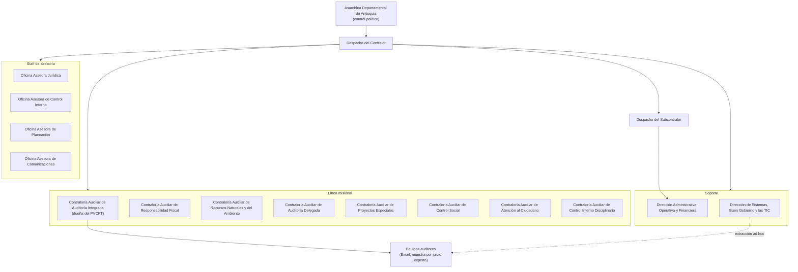
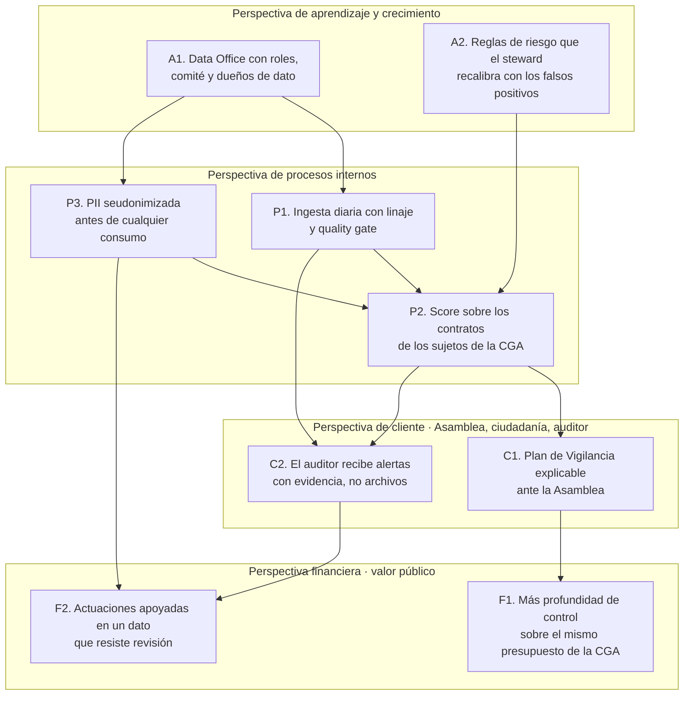
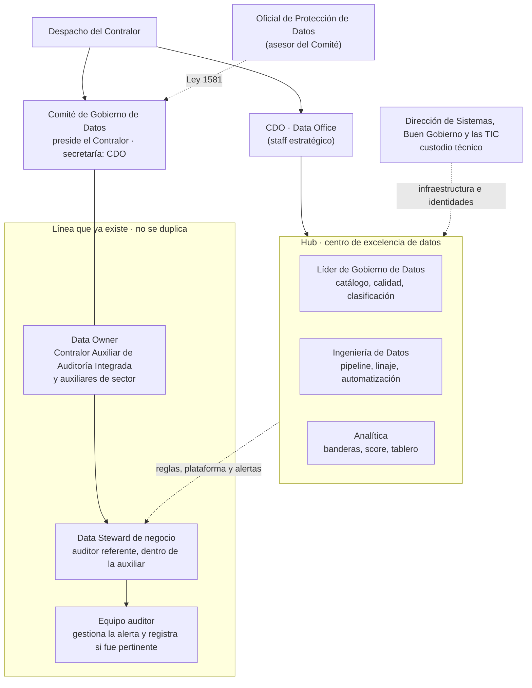

# Estrategia corporativa de ORCA

**Propuesta ante comité directivo · ítems 3.1, 3.2 y 3.3**

|                               |                                                                                                                                                  |
| ----------------------------- | ------------------------------------------------------------------------------------------------------------------------------------------------ |
| **Solución**                  | ORCA — Observatorio de Riesgo en Contratación de Antioquia                                                                                       |
| **Organización**              | Contraloría General de Antioquia (CGA)                                                                                                           |
| **Asignatura**                | Data Office Strategy · UPB · 2026-2S · Docente: María Victoria Valencia Arango                                                                   |
| **Fecha**                     | 15 de octubre de 2026                                                                                                                            |
| **Equipo**                    | Luis Ángel Seoanes Ovieso · Julian Amariles Taborda · Jhon Sebastian Rayo Posada · Katheryn Ramírez Chimá                                        |
| **Alcance de este documento** | Diagnóstico, alternativas y decisión, estrategia y diseño organizacional. La ejecución y la gestión del cambio (ítem 3.4) se desarrollan aparte. |

> Pregunta que responde este documento: **¿qué estrategia corporativa justifica a ORCA y cómo tiene que organizarse la Contraloría para que funcione?**

---

## 0. La organización y por qué es esta

SECOP II no tiene un “dueño de negocio” que decida qué vigilar. El publicador es Colombia Compra Eficiente; quien puede convertir ese dato en una actuación fiscal en Antioquia es la **Contraloría General de Antioquia**.

La CGA es un órgano de control autónomo del orden departamental. Su mandato es vigilar la gestión fiscal de los recursos públicos del departamento. En 2025 auditó el **100 % de sus 476 sujetos de control activos** (el 97 % de 489 sujetos de vigilancia) y evaluó recursos por **$16,5 billones**, equivalentes al **82 %** del presupuesto de esos sujetos (Contraloría General de Antioquia [CGA], 2026). Esos 476 sujetos son 119 municipios, 113 Empresas Sociales del Estado, 161 empresas de servicios públicos, 15 entidades del orden departamental y 68 establecimientos públicos. Seis municipios quedan por fuera porque tienen contraloría propia: Medellín, Envigado, Bello, Itagüí, Sabaneta y Rionegro (CGA, 2026).

La estructura vigente viene de la **Ordenanza 20 de 2016** de la Asamblea Departamental. El direccionamiento de los últimos cuatro años está en el Plan Estratégico Corporativo 2022-2025, cerrado con un avance del **97,59 %** (CGA, 2026). Ese cierre abre la ventana para inscribir una capacidad nueva en el plan que sigue.

**Dato propio que sostiene el problema.** Sobre contratos de entidades con sede en Antioquia firmados entre el 1 de enero de 2024 y el 27 de septiembre de 2026, el perfilamiento de SECOP II (`jbjy-vk9h`, consulta del 27-sep-2026, reproducible en `notebooks/00_perfilamiento_fuente.ipynb`) muestra:

| Hallazgo                                                 | Cifra                                                                          |
| -------------------------------------------------------- | ------------------------------------------------------------------------------ |
| Contratos firmados                                       | **302.507**, por **$56,4 billones**                                            |
| Contratación directa                                     | **85,5 %**                                                                     |
| Contratos de enero de 2026, antes de la Ley de Garantías | **49.906** (93,8 % directa), frente a 1.382–1.741 por mes entre febrero y mayo |
| Contratos con personas naturales                         | **81,5 %**                                                                     |

La CGA ya toca a casi todas sus entidades. Lo que no tiene es una forma sistemática de ver el contrato: en un solo mes se firmó el 16 % de todo lo contratado en casi tres años, y ese pico no entra hoy al Plan de Vigilancia como una señal medida. El universo del score de ORCA no es el departamento entero. Es el subconjunto territorial que sí vigila la CGA, cruzado con la lista maestra de sujetos de control. El orden nacional y las seis contralorías municipales se conservan como comparación y quedan fuera del score.

---

## 3.1 Diagnóstico

Se aplican cuatro herramientas al caso: **PESTEL**, **cinco fuerzas de Porter** (adaptadas a un órgano de control, que no compite por cuota de mercado), **FODA** y **FODA cruzada**. La estructura as-is se diagnostica con jerarquía, especialización, centralización y formalización.

### 3.1.1 Entorno externo: PESTEL

PESTEL ordena el entorno que la CGA no controla. El sector de referencia es el control fiscal territorial sobre la contratación pública. Cada fila junta un hecho externo con la consecuencia que ese hecho tiene para ORCA. Las cifras de la entidad son resultados ya publicados, no metas del proyecto.

| Factor          | Evidencia                                                                                                                                                                                                                                                                                                                                                                                                                                                                                                                                                                                                                                                                                                                                                                                                    | Qué le exige a la CGA                                                                                                                                                                                                                                                                                                                                 |
| --------------- | ------------------------------------------------------------------------------------------------------------------------------------------------------------------------------------------------------------------------------------------------------------------------------------------------------------------------------------------------------------------------------------------------------------------------------------------------------------------------------------------------------------------------------------------------------------------------------------------------------------------------------------------------------------------------------------------------------------------------------------------------------------------------------------------------------------ | ----------------------------------------------------------------------------------------------------------------------------------------------------------------------------------------------------------------------------------------------------------------------------------------------------------------------------------------------------- |
| **Político**    | El control fiscal puede ser preventivo y concomitante, además de posterior y selectivo, “en tiempo real… mediante el uso de tecnologías de la información”, sin coadministrar (Acto Legislativo 04 de 2019; Decreto 403 de 2020). El PEC 2022-2025 cierra en 97,59 % (CGA, 2026). En 2026 hay elección presidencial y la Ley 996 de 2005 restringe la contratación directa en los cuatro meses previos.                                                                                                                                                                                                                                                                                                                                                                                                      | El plan que sigue al PEC puede inscribir una vigilancia más oportuna. En el extracto de SECOP, enero de 2026 concentró la firma de contratos antes de esa ventana. Esa concentración es una señal para priorizar la revisión, no un hallazgo fiscal.                                                                                                  |
| **Económico**   | En 2025 la CGA evaluó recursos por $16,5 billones, el 82 % del presupuesto de sus sujetos (CGA, 2026). Esa cifra no es el mismo universo ni el mismo periodo que los $56,4 billones de contratos SECOP firmados por entidades de Antioquia entre 2024 y septiembre de 2026 (dato propio): el primer valor es presupuesto evaluado en un año; el segundo es valor contratado en un corte más largo y en todo el departamento. Los hallazgos con presunta incidencia fiscal pasaron de **$128.277 millones** en 2024 (225 hallazgos) a **$26.962 millones** en 2025 (136 hallazgos). Los beneficios cuantitativos del control pasaron de $182.104 millones en 2024 a $32.899 millones en 2025 (CGA, 2025a, 2026). El presupuesto ejecutado por la propia CGA en 2024 fue de **$46.381 millones** (CGA, 2025a). | La profundidad del control tiene que aumentar con el recurso que la entidad ya ejecuta. Un hallazgo apoyado en un dato erróneo le cuesta credibilidad a una institución cuyo presupuesto ejecutado en 2024 fue de $46.381 millones. La caída de los hallazgos entre 2024 y 2025 es un resultado observado; ORCA no la toma como meta ni como fracaso. |
| **Social**      | La misión institucional incluye el control social (CGA, s. f.). La ciudadanía ve el contrato en SECOP, pero el resultado de la vigilancia llega cuando el gasto ya ocurrió. El 81,5 % de los contratos del extracto departamental son con personas naturales: hay titulares de datos, no solo “proveedores”.                                                                                                                                                                                                                                                                                                                                                                                                                                                                                                 | La propuesta de valor hacia afuera es una vigilancia más oportuna. Hacia adentro, el dato personal no puede seguir copiado en archivos sueltos.                                                                                                                                                                                                       |
| **Tecnológico** | SECOP II se actualiza a diario en datos.gov.co (6.070.870 filas y último cargue el 27-sep-2026 en el perfilamiento). El publicador recarga el dataset completo cada día: 576.686 registros de Antioquia compartían la misma marca `:updated_at`. El campo de negocio `ultima_actualizacion` viene vacío en el 97,8 % (dato propio, documento 02). La CGA opera con la Guía de Auditoría Territorial 4.0 (CGA, 2026), sin una función de datos.                                                                                                                                                                                                                                                                                                                                                               | Hay API y no hay capacidad para usarla. La ingesta no puede depender de una marca de agua que el publicador reescribe.                                                                                                                                                                                                                                |
| **Ambiental**   | La CGA tiene Contraloría Auxiliar de Recursos Naturales y del Ambiente, y la línea 1 del PEC es “control fiscal y ambiental” (CGA, 2026). Parte de la contratación usa regalías y obra pública.                                                                                                                                                                                                                                                                                                                                                                                                                                                                                                                                                                                                              | El primer producto de ORCA es el riesgo contractual. El cruce ambiental queda como evolución, cuando el dato de contratación ya esté gobernado.                                                                                                                                                                                                       |
| **Legal**       | Transparencia: Ley 1712 de 2014. Protección de datos: Ley 1581 de 2012. Explotación de datos públicos: CONPES 3920 de 2018. Estructura de la entidad: Ordenanza 20 de 2016. Control preventivo sin coadministración: Decreto 403 de 2020.                                                                                                                                                                                                                                                                                                                                                                                                                                                                                                                                                                    | Reutilizar SECOP dentro de la contraloría es un tratamiento nuevo. La capa cruda se conserva con acceso restringido; el tablero no muestra cédulas. El score prioriza; la actuación la firma un rol con nombre.                                                                                                                                       |

El entorno abre y limita a la vez. El Decreto 403 de 2020 y la API diaria permiten una vigilancia más temprana; la Ley 1581 de 2012 y la prohibición de coadministrar impiden que el score reemplace al auditor o que el tablero publique cédulas. El PEC 2022-2025 cerró en 97,59 % (CGA, 2026): esa cifra es un avance observado del plan que termina, y deja la ventana para inscribir la capacidad en el plan siguiente. Los hallazgos fiscales y el presupuesto ejecutado también son historia de la entidad. ORCA no se propone “mejorar” esas cifras en el primer ciclo.

### 3.1.2 Entorno sectorial: cinco fuerzas de Porter

Las cinco fuerzas se adaptan aquí al sector público. La CGA no compite por precio ni por cuota de mercado. El modelo se usa para leer presiones sobre el mandato y sobre la legitimidad: quién más puede controlar el mismo recurso, quién puede leer SECOP antes que la entidad y qué ocurre si la selección del contrato sigue sin una regla explícita.

| Fuerza                             | Lectura en este sector                                                                                                                                                                                                                                                                                                                                                                                          | Intensidad                                | Consecuencia para la estrategia                                                                                                                                                     |
| ---------------------------------- | --------------------------------------------------------------------------------------------------------------------------------------------------------------------------------------------------------------------------------------------------------------------------------------------------------------------------------------------------------------------------------------------------------------- | ----------------------------------------- | ----------------------------------------------------------------------------------------------------------------------------------------------------------------------------------- |
| **Rivalidad entre “competidores”** | El control del mismo recurso lo pueden ejercer la Contraloría General de la República (competencia prevalente del Acto Legislativo 04 de 2019), la Procuraduría en lo disciplinario, la Fiscalía en lo penal y las seis contralorías municipales en su jurisdicción. En 2025 la CGA trasladó el 100 % de los hallazgos disciplinarios y penales dentro de término (CGA, 2026).                                  | Media                                     | ORCA no invade esos fueros. Produce mejor insumo para la actuación fiscal propia y para el traslado oportuno.                                                                       |
| **Entrada de nuevos actores**      | El monopolio legal del control fiscal territorial es alto: no aparece una contraloría nueva por decreto de un privado. Sí aparecen capacidades externas que leen SECOP antes que la entidad (veedurías, academia, prensa de datos, herramientas de la Open Contracting Partnership).                                                                                                                            | Baja en lo legal, alta en lo reputacional | Si el patrón de enero de 2026 lo publica un tercero antes que la CGA, el costo es de legitimidad, no de mercado.                                                                    |
| **Poder de los proveedores**       | El insumo crítico tiene un solo proveedor: Colombia Compra Eficiente, vía la API SODA de datos.gov.co. Cambia columnas sin aviso y reescribe el histórico cada día (dato propio). DIVIPOLA (DANE) es el único maestro de municipios.                                                                                                                                                                            | Alta                                      | La estrategia incluye validación de esquema por lote y ventana móvil con hash por registro. Depender de un CSV manual deja a la entidad en manos del proveedor y de la Oficina TIC. |
| **Poder de los clientes**          | Quien “compra” el control es la Asamblea Departamental, que recibe los informes, y la ciudadanía, que financia la entidad. En 2025 los informes fiscales y financieros de 9 subregiones, 15 entidades descentralizadas y la Gobernación se entregaron a la Asamblea (CGA, 2026). Los sujetos de control pueden demorar los soportes; en el proceso actual esa espera es de 10 días hábiles y se reitera a mano. | Media-alta                                | El Plan de Vigilancia tiene que ser explicable ante la Asamblea. El score es el argumento; el juicio del auditor sigue siendo la decisión.                                          |
| **Sustitutos**                     | El sustituto real de una priorización por riesgo es seguir con el control posterior por muestreo y juicio experto, que la entidad ya cumple al 100 % de sujetos. Otro sustituto es que la CGR ejerza la competencia prevalente con sus propias herramientas.                                                                                                                                                    | Media                                     | Cumplir el plan por entidad ya está resuelto. El sustituto que hay que volver obsoleto es la selección del contrato “porque siempre se ha hecho así”.                               |

La presión más concreta está en el proveedor único del dato y en la legitimidad: si un tercero describe antes el patrón de enero de 2026, el costo para la CGA es de relevancia institucional. La cobertura del 100 % de los 476 sujetos activos ya es un resultado de 2025 (CGA, 2026); no es una meta de ORCA. La respuesta que cabe en el mandato es una capacidad interna de ingesta, calidad y priorización, sobre esos mismos sujetos. El orden nacional y las seis contralorías municipales quedan fuera de esa respuesta.

### 3.1.3 Situación interna: FODA

FODA separa lo interno de lo externo. Fortalezas y debilidades están dentro de la CGA: la cobertura que ya logra, el método de auditoría y la ausencia de roles de datos. Oportunidades y amenazas están fuera: la API de SECOP, el marco de política pública, los cambios del publicador y el riesgo jurídico. Tratar un defecto interno como si fuera del entorno, o una amenaza externa como si fuera una falla de gestión, cambiaría la acción que después se elige.

| **Fortalezas**                                                                                                                                                                                                                                                                 | **Debilidades**                                                                                                                                                                                                                                                                                |
| ------------------------------------------------------------------------------------------------------------------------------------------------------------------------------------------------------------------------------------------------------------------------------ | ---------------------------------------------------------------------------------------------------------------------------------------------------------------------------------------------------------------------------------------------------------------------------------------------- |
| **F1.** Cobertura ya lograda: 100 % de 476 sujetos activos y 100 % del PVCFT 2025 (CGA, 2026).                                                                                                                                                                                 | **D1.** La selección del contrato dentro de esa cobertura sigue siendo histórica y por juicio experto. El pico de 49.906 contratos de enero de 2026 no tiene un detector.                                                                                                                      |
| **F2.** Metodología formal (GAT 4.0), 14 procesos del sistema de gestión y cadena de traslado al 100 % de oportunidad (CGA, 2026).                                                                                                                                             | **D2.** Extracción manual de SECOP y depuración en Excel, sin linaje ni reglas de calidad. En el perfilamiento: 40.638 contratos de Antioquia sin fecha de firma en todo el histórico; 20.706 con ciudad “No Definido” en el corte desde 2024; 2.848 con valor $0 (dato propio, documento 02). |
| **F3.** Conocimiento de negocio repartido en contralorías auxiliares especializadas (auditoría integrada, responsabilidad fiscal, ambiente, control social).                                                                                                                   | **D3.** No existen roles de datos (owner, steward, CDO). El dato de contratación no tiene dueño; TIC extrae cuando el volumen no cabe en el portal.                                                                                                                                            |
| **F4.** Mandato constitucional y legal para usar tecnología en el seguimiento permanente, sin que se le oponga reserva (Decreto 403 de 2020).                                                                                                                                  | **D4.** El 81,5 % de los contratos del extracto departamental tiene persona natural. La reutilización interna copia cédulas sin política de finalidad ni seudonimización.                                                                                                                      |
| **Oportunidades**                                                                                                                                                                                                                                                              | **Amenazas**                                                                                                                                                                                                                                                                                   |
| **O1.** API diaria de SECOP II y licencia CC BY-SA 4.0. El dato ya está publicado.                                                                                                                                                                                             | **A1.** Colombia Compra Eficiente cambia el esquema o recarga el histórico sin aviso. Una marca de agua ingenua trae todo el dataset, todos los días.                                                                                                                                          |
| **O2.** Cierre del PEC 2022-2025 (97,59 %): el plan nuevo puede crear la función de datos sin esperar otra vigencia completa.                                                                                                                                                  | **A2.** Un hallazgo construido sobre un valor mal digitado o una fecha nula se cae en la actuación y daña la credibilidad.                                                                                                                                                                     |
| **O3.** CONPES 3920 y el marco de datos abiertos permiten tratar la contratación como activo gobernado, con herramientas sin licencia (Python, GitHub).                                                                                                                        | **A3.** Tratamiento indebido de datos personales (Ley 1581) o una alerta pública prematura que parezca coadministración (Decreto 403 de 2020).                                                                                                                                                 |
| **O4.** Patrones ya visibles en el dato propio (directa del 85,5 % en el extracto departamental; ventana pre-Ley de Garantías). La literatura de integridad los trata como señales para revisar primero, no como prueba de irregularidad (Open Contracting Partnership, 2016). | **A4.** Resistencia de los equipos de auditoría (“siempre se ha auditado así”) y fatiga si las señales generan muchos falsos positivos.                                                                                                                                                        |

La tensión que importa está entre F1 y D1. La CGA ya cubre a sus sujetos de control; dentro de esa cobertura, la elección del contrato no queda explicada por una señal medida. El pico de 49.906 contratos en enero de 2026 pertenece al extracto departamental de SECOP, no a un hallazgo fiscal de la entidad. Muestra qué tipo de patrón hoy no entra de forma sistemática al Plan de Vigilancia.

### 3.1.4 Matriz FODA cruzada

El cruce combina un factor interno con uno externo y produce una acción. No repite el diagnóstico.

- **FO** usa una fortaleza para aprovechar una oportunidad.
- **DO** corrige una debilidad con una oportunidad que ya está disponible.
- **FA** usa una fortaleza para contener una amenaza.
- **DA** evita que una debilidad quede expuesta a una amenaza. Aquí la acción es acotar el alcance y no adelantar productos para los cuales el dato todavía no alcanza.

Esas acciones alimentan las alternativas del apartado 3.2.

|                         | **Oportunidades (O1–O4)**                                                                                                                                                                                                                                                                                                      | **Amenazas (A1–A4)**                                                                                                                                                                                                                                                                                                                                                                                              |
| ----------------------- | ------------------------------------------------------------------------------------------------------------------------------------------------------------------------------------------------------------------------------------------------------------------------------------------------------------------------------ | ----------------------------------------------------------------------------------------------------------------------------------------------------------------------------------------------------------------------------------------------------------------------------------------------------------------------------------------------------------------------------------------------------------------- |
| **Fortalezas (F1–F4)**  | **FO — usar lo que ya funciona para tomar el dato.** FO1. Sobre la cobertura del 100 % de sujetos y la GAT 4.0, montar un score de riesgo contractual con la API de SECOP (F1, F2, O1, O4). FO2. Inscribir esa capacidad en el plan estratégico que reemplaza al PEC 2022-2025, amparados en el Decreto 403 (F4, O2, O3).      | **FA — proteger la credibilidad que ya se tiene.** FA1. Quality gate por lote (umbral 95 %) y validación de esquema antes de publicar, para que un cambio de SECOP o un valor absurdo no llegue a un informe (F2, A1, A2). FA2. Seudonimizar en la capa curada y dejar la actuación en un rol humano, de modo que la alerta no se vuelva coadministración ni exposición de cédulas (F4, A3).                      |
| **Debilidades (D1–D4)** | **DO — cubrir el hueco con el dato que ya existe.** DO1. Usar las banderas como primer filtro de prioridad, sin ampliar la planta de auditores y sin convertir la señal en actuación automática (D1, O1, O4). DO2. Crear roles de datos y un pipeline con linaje, en lugar de seguir pidiendo extracciones a TIC (D2, D3, O3). | **DA — no abrir frentes mientras el dato esté inmaduro.** DA1. Acotar el score a los sujetos de control de la CGA. Dejar fuera a Medellín, Envigado, Bello, Itagüí, Sabaneta y Rionegro, y fuera el orden nacional (D3, A4). DA2. No publicar indicadores ciudadanos ni modelos predictivos en el primer ciclo: sin falsos positivos etiquetados por el auditor, el modelo aprendería del ruido (D1, D4, A2, A3). |

FO1 y DO1 empujan a priorizar dentro del mandato actual. FA1 y FA2 les ponen condición: el lote se publica si pasa el umbral de calidad, la PII se seudonimiza y la actuación queda en un rol humano. DA1 y DA2 dejan fuera, en esta etapa, la expansión territorial y el producto predictivo público. Esa combinación es la que el apartado 3.2 evalúa como alternativa A, con la defensa de E incorporada y con B, C y D por fuera del primer ciclo.

### 3.1.5 Estructura actual (as-is)

La CGA es una organización **lineal-staff, de base funcional**. La línea ejecuta el control; el staff asesora y soporta. No es matricial, ni en red, ni ágil. La Ordenanza 20 de 2016 fija las dependencias; el informe de gestión 2025 y el listado de jefes confirman que esa planta directiva sigue en operación (CGA, 2025b, 2026).

No hay ninguna caja de datos. Quien más se le acerca es la Dirección de Sistemas, Buen Gobierno y las TIC, y su papel real en el proceso de vigilancia es el de extraer archivos cuando el portal no da abasto.

**Diagnóstico con las cuatro variables**

| Variable            | Nivel                                          | Evidencia                                                                                                                                                                                                 | Efecto sobre ORCA                                                                                                                                                            |
| ------------------- | ---------------------------------------------- | --------------------------------------------------------------------------------------------------------------------------------------------------------------------------------------------------------- | ---------------------------------------------------------------------------------------------------------------------------------------------------------------------------- |
| **Jerarquía**       | Alta                                           | Cadena Contralor → Subcontralor → contralor auxiliar → equipo auditor, fijada por ordenanza. Un hallazgo fiscal solo sale por esa cadena, con traslado a responsabilidad fiscal, Procuraduría o Fiscalía. | La actuación debe seguir subiendo por la línea. Meter el score en un atajo rompe la rendición de cuentas.                                                                    |
| **Especialización** | Alta en el control, nula en el dato            | Ocho contralorías auxiliares por materia y 14 procesos del sistema de gestión. Nadie tiene por función la calidad, el catálogo o el linaje de SECOP.                                                      | El conocimiento de “qué es riesgoso en salud o en regalías” ya está en las auxiliares. La especialización que falta es la del dato, y no se improvisa dentro de cada equipo. |
| **Centralización**  | Alta en la decisión; fragmentada en el insumo  | El PVCFT se cumple al 100 % desde Auditoría Integrada (CGA, 2026). El contrato, en cambio, se busca en el portal o se pide a TIC y se depura en libros distintos.                                         | Hay que centralizar la plataforma y las reglas, y dejar descentralizada la decisión de actuar. Hoy está al revés: se centraliza el plan y se dispersa el dato.               |
| **Formalización**   | Alta en el proceso auditor; ausente en el dato | GAT 4.0, manual de gestión institucional, resoluciones de rendición de cuentas. Cero políticas de calidad, clasificación o seudonimización para la reutilización de SECOP.                                | Conviene formalizar el dato con pocas reglas duras (quality gate, clasificación, linaje) y evitar un procedimiento nuevo por cada alerta.                                    |

La madurez del dato, en los términos ya usados en el proyecto, está en nivel 1: sin roles, sin políticas, sin linaje y con analítica ad hoc. La madurez del control fiscal de la entidad es otra cosa, y es alta. Confundir las dos lleva a proponer una reorganización que la ordenanza no permite y que el comité no necesita.

---

## 3.2 Alternativas y decisión

### 3.2.1 Divergencia

Las alternativas salen de dos marcos usados a la vez. La **matriz de Ansoff** separa el mandato que ya se tiene de un mandato o un territorio nuevo, y el producto de control actual de un producto nuevo. La **FODA cruzada** exige que cada alternativa nazca de un cruce, no de una preferencia suelta. Se formularon cinco. Las cuatro que no se eligen permanecen en la tabla y en la matriz de decisión.

| #     | Alternativa                                                | Lugar en Ansoff                                                | De qué cruce FODA sale                                                              | Qué haría la CGA                                                                                                                                                              |
| ----- | ---------------------------------------------------------- | -------------------------------------------------------------- | ----------------------------------------------------------------------------------- | ----------------------------------------------------------------------------------------------------------------------------------------------------------------------------- |
| **A** | **Priorización por riesgo sobre el mandato actual** (ORCA) | Penetración: mismos sujetos, más profundidad del mismo control | FO1, FO2, DO1, DO2, FA1, FA2                                                        | Ingesta diaria de SECOP, calidad medida, PII seudonimizada y score con banderas rojas para priorizar contratos dentro de los 476 sujetos. La máquina mide; la persona decide. |
| **B** | **Observatorio predictivo y público desde el primer año**  | Desarrollo de producto                                         | O4 llevado más lejos de lo que DA2 permite                                          | Modelos de anomalía y tablero ciudadano con alertas abiertas, además del score. Exige falsos positivos ya etiquetados y un criterio de reserva de la actuación.               |
| **C** | **ORCA como servicio compartido**                          | Desarrollo de mercado                                          | Contradice DA1                                                                      | Ofrecer la plataforma a las contralorías de Medellín, Envigado, Bello, Itagüí, Sabaneta y Rionegro, y luego a otros departamentos.                                            |
| **D** | **Plataforma única de control integral**                   | Diversificación                                                | Contradice DA2 y el factor ambiental del PESTEL, que se dejó para una segunda etapa | Un solo motor para contratación, presupuesto, ambiente, disciplinario y denuncias, con analítica avanzada operada como servicio interno.                                      |
| **E** | **Oficina de calidad del dato, sin score**                 | Penetración defensiva, sin ataque                              | FA1 aislada de FO1 y DO1                                                            | Catálogo, linaje y seudonimización. El auditor sigue eligiendo la muestra por juicio experto.                                                                                 |

Las cinco no son matices de la misma apuesta. A profundiza el control sobre los sujetos actuales. E se queda en ese mismo mandato y ordena el dato, sin cambiar la forma de elegir el contrato. B crea un producto nuevo, la predicción publicada, sobre los mismos sujetos. C lleva un producto parecido a otras contralorías. D cambia a la vez el producto y el ámbito. A y E pueden verse cercanas en Ansoff y, aun así, competir en la matriz: una combina defensa y priorización; la otra se detiene en la defensa.

A y E comparten, además, el balance de Dallemule y Davenport (2017) solo en parte. A pone la defensa cerca del 60 % (calidad, privacidad, linaje) y la priorización cerca del 40 %. E se queda en la defensa. Una bandera roja, en A, es una señal para revisar primero. No acredita una irregularidad ni una responsabilidad fiscal.

### 3.2.2 Convergencia: matriz de decisión ponderada

Escala de 1 a 5. El puntaje de cada alternativa es la suma de nota × peso. Los pesos suman 100 % (30 + 25 + 20 + 15 + 10). Las notas son valoraciones del equipo. Si el comité cambia un peso o una nota, el orden puede moverse. Por eso la cuenta queda visible y no solo el ganador.

| Criterio                                                                          | Peso     | Por qué pesa eso                                                                                                                                                                                                                                                                                         |
| --------------------------------------------------------------------------------- | -------- | -------------------------------------------------------------------------------------------------------------------------------------------------------------------------------------------------------------------------------------------------------------------------------------------------------- |
| **Impacto en el mandato**                                                         | **30 %** | La CGA existe para vigilar el patrimonio público. Una estrategia que no cambie qué contrato se revisa primero deja intacto el problema, aunque el organigrama quede impecable. Es el criterio de mayor peso porque es la razón de la entidad.                                                            |
| **Riesgo legal y de credibilidad** (se puntúa alto cuando el riesgo es manejable) | **25 %** | Un informe basado en un dato erróneo, una cédula expuesta o una alerta que parezca coadministración cuestan más que la herramienta. El presupuesto de la CGA en 2024 fue de $46.381 millones; los hallazgos fiscales de ese año sumaron $128.277 millones (CGA, 2025a). El riesgo pesa más que el costo. |
| **Capacidad interna**                                                             | **20 %** | El primer año no trae una planta nueva de auditores. La alternativa tiene que caber en la GAT 4.0, en la Ordenanza 20 y en un equipo pequeño de datos.                                                                                                                                                   |
| **Tiempo a un resultado visible**                                                 | **15 %** | El PEC acaba de cerrarse y la ventana del plan nuevo es este ciclo. Un resultado que tarde más de un año llega cuando el caso de la Ley de Garantías ya no sirve para aprender.                                                                                                                          |
| **Costo y sostenibilidad**                                                        | **10 %** | El volumen del extracto departamental cabe en archivos locales y software libre. Entre alternativas viables para una entidad pública, el costo separa poco. Por eso pesa menos. El peso bajo no significa que el costo sea irrelevante: significa que no es lo que decide.                               |

| Criterio (peso)               | A. ORCA, priorizar por riesgo | B. Predictivo y público ya | C. Servicio a otras contralorías | D. Control integral | E. Solo calidad, sin score |
| ----------------------------- | ----------------------------- | -------------------------- | -------------------------------- | ------------------- | -------------------------- |
| Impacto en el mandato (30 %)  | 5                             | 4                          | 4                                | 3                   | 2                          |
| Riesgo manejable (25 %)       | 4                             | 2                          | 2                                | 1                   | 5                          |
| Capacidad interna (20 %)      | 4                             | 2                          | 1                                | 1                   | 5                          |
| Tiempo a valor (15 %)         | 5                             | 2                          | 1                                | 1                   | 4                          |
| Costo y sostenibilidad (10 %) | 5                             | 3                          | 2                                | 1                   | 4                          |
| **Puntaje ponderado**         | **4,55**                      | **2,70**                   | **2,25**                         | **1,60**            | **3,85**                   |

Cálculo de cada alternativa, en el mismo orden de criterios (impacto, riesgo manejable, capacidad, tiempo, costo):

| Alternativa | Operación                                                                                         | Puntaje  |
| ----------- | ------------------------------------------------------------------------------------------------- | -------- |
| A           | (5 × 0,30) + (4 × 0,25) + (4 × 0,20) + (5 × 0,15) + (5 × 0,10) = 1,50 + 1,00 + 0,80 + 0,75 + 0,50 | **4,55** |
| B           | (4 × 0,30) + (2 × 0,25) + (2 × 0,20) + (2 × 0,15) + (3 × 0,10) = 1,20 + 0,50 + 0,40 + 0,30 + 0,30 | **2,70** |
| C           | (4 × 0,30) + (2 × 0,25) + (1 × 0,20) + (1 × 0,15) + (2 × 0,10) = 1,20 + 0,50 + 0,20 + 0,15 + 0,20 | **2,25** |
| D           | (3 × 0,30) + (1 × 0,25) + (1 × 0,20) + (1 × 0,15) + (1 × 0,10) = 0,90 + 0,25 + 0,20 + 0,15 + 0,10 | **1,60** |
| E           | (2 × 0,30) + (5 × 0,25) + (5 × 0,20) + (4 × 0,15) + (4 × 0,10) = 0,60 + 1,25 + 1,00 + 0,60 + 0,40 | **3,85** |

**Lectura de los puntajes, para que el comité pueda discutir una nota y no el conjunto.**

- **A (4,55), elegida.** Cambia el criterio con el que se elige el contrato dentro del mandato actual. El riesgo legal queda acotado porque la PII se seudonimiza, el lote que no pasa el umbral no se publica y la actuación sigue en la línea. Cabe en la capacidad actual: Python, API pública y los auditores que ya existen. La meta de este ciclo es el score sobre los sujetos de control de la CGA, no sobre los 302.507 contratos del extracto departamental.
- **E (3,85), la más fuerte de las descartadas.** Es la más segura y la más fácil. Pierde en impacto: un catálogo sin score no le dice al auditor por dónde empezar, y el pico de enero de 2026 seguiría sin detector. Se adopta su contenido (calidad, linaje, seudonimización) como la mitad defensiva de A, no como estrategia completa.
- **B (2,70).** El producto es atractivo y es la evolución natural de A. Hoy no hay falsos positivos etiquetados con los cuales entrenar, y publicar alertas antes de una actuación roza la reserva del proceso y la Ley 1581. Queda en la hoja de ruta, después del primer ciclo de retroalimentación del auditor.
- **C (2,25).** Multiplica el impacto territorial y sale de la jurisdicción. Exige convenios, datos maestros de otras entidades y una planta de soporte que la CGA no tiene. Medellín y las otras cinco contralorías municipales siguen fuera del score.
- **D (1,60).** Diluye el problema que el dato ya midió. Ambiente, disciplinario y presupuesto son procesos maduros de la entidad; meterlos en el mismo motor, en el primer año, retrasa el quality gate de contratación y se parece a coadministrar el ciclo entero del recurso.

**Decisión.** Se aprueba la alternativa A. Las alternativas B, C, D y E quedan descartadas como estrategia de este ciclo. De E se conserva el mecanismo de defensa. De B se conserva el destino de la segunda etapa. C y D no se ejecutan.

---

## 3.3 Estrategia y diseño organizacional

### 3.3.1 Estrategia elegida y objetivos básicos

**Estrategia.** Penetración del mandato actual: la CGA sigue vigilando a los mismos sujetos, con la misma GAT y la misma línea de mando, y cambia el criterio con el que elige el contrato. El dato de SECOP pasa a ser un activo gobernado (defensa) que alimenta un score de riesgo (ataque), en un balance aproximado de 60/40, siguiendo a Dallemule y Davenport (2017).

Esta estrategia se inscribe en la línea 1 del PEC vigente, “control fiscal y ambiental oportuno y veraz” (CGA, 2026), y en el control preventivo del Decreto 403 de 2020. No crea un producto para la venta ni una jurisdicción nueva.

**Conexión con los cuatro objetivos básicos.** En una contraloría, rentabilidad no significa utilidad. Significa que el recurso de control rinda más vigilancia por peso gastado.

| Objetivo básico                                      | Cómo lo mueve ORCA                                                                                                                                                                                                                                                                                                                                 | Hecho que lo ancla                                                                                                                                                     |
| ---------------------------------------------------- | -------------------------------------------------------------------------------------------------------------------------------------------------------------------------------------------------------------------------------------------------------------------------------------------------------------------------------------------------- | ---------------------------------------------------------------------------------------------------------------------------------------------------------------------- |
| **Rentabilidad** (eficiencia del recurso de control) | La misma planta de Auditoría Integrada revisa primero los contratos que concentran el riesgo, en lugar de repartir la muestra por costumbre. El presupuesto de la CGA se queda en el orden ya ejecutado ($46.381 millones en 2024); lo que cambia es el rendimiento de ese gasto.                                                                  | Cobertura de sujetos ya en 100 % (CGA, 2026). El margen está en el contrato, no en abrir más entidades.                                                                |
| **Sostenibilidad**                                   | Institucional: roles, comité y plan de gobierno que sobreviven al cierre del PEC. Jurídica: seudonimización y finalidad (Ley 1581) para que el activo sea usable en la siguiente vigencia. El componente ambiental del PEC no se abandona; queda explícitamente para cuando el dato contractual esté estable.                                      | 81,5 % de contratos con persona natural (dato propio). Sin esa regla, la estrategia se agota en el primer incidente.                                                   |
| **Innovación**                                       | El cambio, dentro del mismo mandato, es la regla de prioridad. Las banderas (directa por encima del patrón de la entidad, firma en ventana pre-Ley de Garantías, concentración de proveedor, único oferente, valor atípico, fraccionamiento) indican qué contrato revisar primero. No prueban una irregularidad ni constituyen un hallazgo fiscal. | 49.906 contratos en enero de 2026 en el extracto departamental (dato propio). La literatura los trata como señales de planeación (Open Contracting Partnership, 2016). |
| **Productividad**                                    | Sale del proceso la búsqueda manual, la espera a TIC y la depuración en Excel. Entra un lote diario con linaje. El auditor recibe la alerta con el enlace al contrato en SECOP.                                                                                                                                                                    | Dolores D2, D3 y D4 del proceso AS-IS (documento 03). La frescura de 24 horas es meta, no un tiempo que la entidad mida hoy.                                           |

### 3.3.2 Clasificación de la estrategia corporativa

La estrategia elegida se ubica en las cuatro dimensiones del esquema visto en clase (adaptación atribuida a Agurto y Manosalva, 2015). El equipo no contrastó esa adaptación con la publicación original: usa las categorías tal como aparecen en la diapositiva. La clasificación interpreta el diseño propuesto. Queda sujeta a lo que la CGA decida al implementar y al contratar.

#### Según el mercado

ORCA conserva los sujetos de control y el mandato fiscal de la CGA. Lo que profundiza es la selección del contrato, mediante señales de riesgo calculadas sobre SECOP II. El universo del score sigue siendo el de los sujetos que la CGA ya vigila. El orden nacional y las contralorías de Medellín, Envigado, Bello, Itagüí, Sabaneta y Rionegro quedan fuera.

En la matriz de Ansoff esa decisión es penetración: mismo ámbito y mismo producto de control, con más intensidad en la elección de qué revisar (apartado 3.2). En el esquema de la diapositiva, la penetración puede leerse como **crecimiento concentrado** y, dentro de él, como **especialización** en la vigilancia contractual de los sujetos actuales.

Los dos marcos no se equivalen de forma automática. Ansoff cruza producto y mercado. La diapositiva pregunta si la entidad crece diversificando o concentrándose, y si esa concentración es especialización, integración horizontal o integración vertical. La lectura de especialización se sostiene porque ORCA profundiza una actividad que ya es misional. La integración horizontal correspondería a llevar la plataforma a otras contralorías, que es la alternativa C. La integración vertical correspondería a que la CGA pasara a ejecutar el gasto que vigila, y el Decreto 403 de 2020 mantiene esa frontera: el control advierte y no coadministra.

Tampoco es diversificación, ni relacionada ni no relacionada, en la primera etapa. Diversificar abriría otro producto o otro territorio. El primer ciclo no convierte el ambiente, el disciplinario ni el presupuesto en motores nuevos (alternativa D) y no extiende el score a otros departamentos ni a los seis municipios con contraloría propia (alternativa C y cruce DA1). Esas opciones siguen formuladas y descartadas para este ciclo. Pueden reabrirse cuando el dato de contratación esté gobernado y el auditor haya etiquetado qué señales sí sirvieron.

#### Según financiación

Este apartado no demuestra la fuente presupuestal. La CGA no ha apropiado un rubro para ORCA y el equipo no dispone del presupuesto desagregado. Por eso no se concluye que el proyecto se financie de modo conservador o apalancado. Lo que sí describe el diseño técnico es una orientación de bajo costo: datos públicos, software libre y una capacidad que se propone alojar, en principio, en la planta y en la infraestructura que TIC ya custodia.

Con esa información incompleta, el equipo formula una **propuesta inicial de orientación conservadora**. Es un supuesto de trabajo para el comité, no una decisión de Planeación ni de la Dirección Administrativa, Operativa y Financiera.

| Componente                           | Propuesta inicial                                                                                                                                                                                                            |
| ------------------------------------ | ---------------------------------------------------------------------------------------------------------------------------------------------------------------------------------------------------------------------------- |
| Fuente presupuestal                  | Presupuesto institucional de la CGA, dentro del plan de acción que suceda al PEC 2022-2025, previo concepto de Planeación y de la Dirección Administrativa, Operativa y Financiera. A la fecha no hay rubro identificado.    |
| Desarrollo                           | Tiempo de la célula del Data Office y herramientas sin licencia (Python, GitHub y la API pública de datos.gov.co).                                                                                                           |
| Operación                            | Procesamiento y almacenamiento local, en las zonas raw, curated y mart, bajo custodia técnica de TIC.                                                                                                                        |
| Mantenimiento                        | Corrida del pipeline, control de calidad del lote y recalibración de reglas, a cargo del hub y del steward de negocio.                                                                                                       |
| Contratación                         | Primera vía: asignar las funciones nuevas dentro de la planta existente. Una contratación de ingeniería de datos solo si Planeación certifica que esa función no cabe en la planta. No se propone ampliar el equipo auditor. |
| Infraestructura                      | No se propone un centro de datos nuevo ni una nube de pago en el primer ciclo.                                                                                                                                               |
| Financiación externa o endeudamiento | No forman parte de esta propuesta. Un convenio o una transferencia posterior sería un ingreso adicional, no la condición para empezar.                                                                                       |

Si la entidad definiera deuda, cofinanciación o un contrato externo para operar el score, esta clasificación dejaría de aplicar y el apartado tendría que rehacerse con el dato real.

#### Según inversión

La diapositiva separa dos preguntas: dónde se realiza la actividad y de qué forma crece la capacidad.

**Actividad: internalización.** ORCA propone desarrollar dentro de la CGA las capacidades que definen la estrategia: gobierno del dato, ingeniería del pipeline y analítica del score. Consumir los datos de SECOP II, que publica Colombia Compra Eficiente, o apoyarse en herramientas externas (la API SODA, un tablero, el programador de tareas) no saca esas capacidades de la entidad. El publicador sigue siendo dueño de la fuente. La CGA se queda con la regla de calidad, la seudonimización, el linaje y el criterio de prioridad. Externalizar el score o el catálogo devolvería la vigilancia a la extracción a demanda.

**Forma: orgánica.** La propuesta desarrolla capacidades y reparte responsabilidades dentro de la estructura existente: un staff ante el Despacho y stewards en las contralorías auxiliares. No incluye la compra ni la integración de otra organización. Un desarrollo llave en mano, que un tercero se lleve al terminar el contrato, sería inversión inorgánica y no es lo que aquí se plantea.

Las dos lecturas interpretan el diseño. Si en la implementación el motor de riesgo se contratara por fuera, o si se incorporara un equipo ya formado de otra entidad, la actividad o la forma cambiarían.

#### Según forma de departamentalización

La CGA tiene una estructura lineal-staff y de base funcional (apartado 3.1.5). ORCA no propone sustituirla ni crear una contraloría auxiliar nueva, lo que además exigiría modificar la Ordenanza 20 de 2016.

Lo que se incorpora es un Data Office transversal, con un modelo de centro de excelencia federado, que se detalla en el diseño to-be:

- El **hub** centraliza la plataforma, el gobierno de datos, los estándares, la calidad, la ingeniería y la analítica.
- Los **spokes** son las contralorías auxiliares. Aportan el conocimiento sectorial y evalúan las alertas.
- El **Comité de Gobierno de Datos** coordina las decisiones que cruzan a varias auxiliares.
- La **Dirección de Sistemas, Buen Gobierno y las TIC** conserva la custodia técnica: infraestructura, respaldos e identidades.
- Los auditores y la autoridad competente de la línea mantienen la decisión de la actuación fiscal.

La diapositiva distingue departamentalización simple y compleja. El equipo no cuenta con la definición usada en clase para esas dos categorías, más allá de los rótulos. Por eso no clasifica a la CGA, ni al diseño propuesto, como simple o como compleja. Ese punto queda pendiente de validación académica.

### 3.3.3 Mapa estratégico y Balanced Scorecard

El mapa se lee de abajo hacia arriba, como una cadena de causa. Las capacidades de aprendizaje (roles, comité, reglas que el steward puede recalibrar) hacen posibles los procesos: ingesta con linaje, quality gate, seudonimización y score. Esos procesos cambian la información que reciben los usuarios institucionales: la Asamblea obtiene un Plan de Vigilancia explicable y el auditor recibe una alerta con el enlace a la evidencia, en lugar de un archivo sin dueño. Ese uso es el que aporta valor público: más profundidad de control sobre el mismo gasto institucional, y actuaciones que se pueden revisar porque el dato pasó por calidad y por una persona.

La perspectiva superior se llama financiera, como pide el modelo, y aquí se interpreta como valor público. Las cajas superiores son el efecto buscado. No son resultados que ORCA ya haya producido.

**Indicadores del tablero.** Cada KPI tiene fórmula, línea base, meta, frecuencia y responsable. La línea base de los indicadores de datos es cero o “no se mide”, porque la capacidad no existe; donde la entidad ya mide, se usa su cifra.

| Perspectiva | Objetivo del mapa                | KPI                                                              | Fórmula                                                                                     | Línea base                                                                                                             | Meta                                            | Frecuencia               | Responsable                                            |
| ----------- | -------------------------------- | ---------------------------------------------------------------- | ------------------------------------------------------------------------------------------- | ---------------------------------------------------------------------------------------------------------------------- | ----------------------------------------------- | ------------------------ | ------------------------------------------------------ |
| Aprendizaje | A1. Roles vivos                  | Activos del catálogo con owner y steward                         | Activos con ambos roles / activos del catálogo de contratación                              | 0 % (no hay catálogo)                                                                                                  | 100 %                                           | Trimestral               | Líder de Gobierno de Datos                             |
| Aprendizaje | A2. Reglas que aprenden          | Versión de reglas vigente y usada                                | Score calculado con la versión publicada / scores del periodo                               | No existe versión                                                                                                      | 100 % de los scores con versión trazable        | Mensual                  | Data Steward de negocio                                |
| Procesos    | P1. Lote confiable               | Score de calidad del lote                                        | Promedio ponderado de completitud, validez, exactitud, consistencia, unicidad y oportunidad | No se mide. Referencia del perfilamiento: 40.638 sin fecha de firma en el histórico de Antioquia                       | ≥ 95 % para publicar                            | Por lote (diario)        | Ingeniería de Datos                                    |
| Procesos    | P2. Priorización completa        | Cobertura del score                                              | Contratos del alcance CGA con score / contratos del alcance                                 | 0 %                                                                                                                    | 100 %                                           | Mensual                  | Analítica                                              |
| Procesos    | P3. Privacidad                   | PII en claro en consumo                                          | Campos de cédula o nombre de persona natural visibles en curated, mart o tablero            | Se copian en Excel (sin conteo oficial). En el extracto departamental, 81,5 % de los contratos son con persona natural | 0                                               | Por publicación          | Oficial de Protección de Datos, con Ingeniería         |
| Cliente     | C1. Plan explicable              | Contratos de riesgo alto incorporados al PVCFT con justificación | Contratos de riesgo alto del periodo con decisión registrada / contratos de riesgo alto     | 0 % (la selección no queda explicada por una regla)                                                                    | 100 % con decisión: actuar, vigilar o descartar | Trimestral, con el PVCFT | Contralor Auxiliar de Auditoría Integrada (Data Owner) |
| Cliente     | C2. Alerta útil                  | Precisión de alertas                                             | Alertas que el auditor marca pertinentes / alertas gestionadas                              | No se mide                                                                                                             | ≥ 60 % en el primer trimestre de uso            | Mensual                  | Equipo auditor; la recalibra el Steward                |
| Financiera  | F1. Rendimiento del control      | Frescura del insumo                                              | Horas entre el corte publicado por SECOP y la actualización del tablero                     | Días o semanas, sin registro (extracción a demanda)                                                                    | ≤ 24 horas                                      | Diaria                   | Ingeniería de Datos                                    |
| Financiera  | F2. Actuación con dato revisable | Lotes publicados sin pasar el quality gate                       | Lotes en el tablero con score de calidad < 95 %                                             | No se mide                                                                                                             | 0                                               | Por lote                 | Data Steward                                           |

La columna de línea base registra lo observado o lo que hoy no se mide. La columna de meta es un compromiso futuro. El 100 % de cobertura del score, la frescura de 24 horas y la precisión del 60 % no son resultados actuales. El denominador de la cobertura es el subconjunto de contratos de los sujetos de control de la CGA, con las seis contralorías municipales y el orden nacional por fuera. Los beneficios cuantitativos del control ($32.899 millones en 2025) siguen siendo un resultado institucional ya publicado (CGA, 2026). ORCA no se compromete a subirlos en el primer año: dependen de la actuación del sujeto de control, no solo del score.

### 3.3.4 Estructura propuesta (to-be)

El cambio organiza el dato para atender las debilidades D1 a D4. La línea misional de la Ordenanza 20 de 2016 permanece: las contralorías auxiliares siguen auditando, trasladando y rindiendo cuentas. Una contraloría auxiliar nueva exigiría otra ordenanza y mezclaría el dato con el negocio. La propuesta es de **staff estratégico**, del mismo tipo que Planeación o Jurídica, más una red de stewards en las cajas que ya existen.

| Debilidad                                  | Qué se observa hoy                                                                       | Función del Data Office que la atiende                                                                                                            |
| ------------------------------------------ | ---------------------------------------------------------------------------------------- | ------------------------------------------------------------------------------------------------------------------------------------------------- |
| **D1.** El contrato se elige por costumbre | El PVCFT cubre sujetos; no hay una señal medida para ordenar contratos                   | Analítica: calcula las banderas y el score. El auditor decide si la alerta es pertinente. La señal no es un hallazgo.                             |
| **D2.** Excel sin linaje ni calidad        | Extracciones a demanda y errores de fecha, ciudad y valor en el perfilamiento            | Ingeniería: ingesta por API, linaje por lote y quality gate. El lote por debajo del 95 % no se publica, salvo decisión expresa del steward.       |
| **D3.** El dato no tiene dueño             | No hay owner, steward ni CDO                                                             | Gobierno de datos: catálogo, roles y Comité. TIC sigue como custodio técnico y deja de ser quien “presta” el archivo.                             |
| **D4.** Cédulas en archivos sueltos        | 81,5 % de personas naturales en el extracto departamental, sin política de reutilización | Seudonimización en la capa curated, antes de cualquier consumo, con concepto del Oficial de Protección de Datos. El tablero no muestra la cédula. |

**Qué cambia frente al as-is, variable por variable.**

| Variable        | As-is                                      | To-be                                                                                                                                                                         | Por qué el cambio es este y no una reorganización general                                                                                                                                                             |
| --------------- | ------------------------------------------ | ----------------------------------------------------------------------------------------------------------------------------------------------------------------------------- | --------------------------------------------------------------------------------------------------------------------------------------------------------------------------------------------------------------------- |
| Jerarquía       | Alta, y el dato no tiene lugar en ella     | Igual de alta para la actuación fiscal. Se agrega un staff que reporta al Contralor, al mismo nivel político que Planeación.                                                  | Bajar la jerarquía del control fiscal chocaría con la ordenanza y con la naturaleza del hallazgo. Subir el dato hasta el Despacho le da autoridad sobre las auxiliares sin convertir al CDO en un contralor paralelo. |
| Especialización | Alta en materias de control, nula en datos | Se crea la especialización que falta (gobierno, ingeniería, analítica) en un solo hub. Las auxiliares conservan la especialización de sector.                                 | Repartir ingenieros de datos en cada auxiliar reproduce los Excel actuales, con más personas.                                                                                                                         |
| Centralización  | Plan centralizado, dato fragmentado        | Plataforma, reglas de calidad, política de PII y catálogo centralizados. Decisión de actuar descentralizada en el Data Owner de cada auxiliar.                                | Corrige la paradoja del diagnóstico. El Comité resuelve los empates entre auxiliares cuando una regla de riesgo no le sirve a un sector.                                                                              |
| Formalización   | Alta en auditoría, ausente en el dato      | Políticas cortas y medibles: umbral de 95 %, clasificación de zonas (crudo confidencial, curado interno, mart de alertas confidencial, agregados públicos) y linaje por lote. | La formalización nueva cae sobre el lote, que es automático, y sobre la excepción, que ve el steward. El auditor no gana un formulario por cada contrato.                                                             |

El dato queda en el staff, con reglas de calidad, linaje y seudonimización. La decisión de actuar sigue en la contraloría auxiliar y en el auditor. Esa es la lectura conjunta del cuadro de debilidades y del cuadro de variables.

La ejecución dentro del hub es ágil: una célula ORCA con sprints de dos semanas (producto, gobierno, ingeniería, analítica y un steward rotativo). Eso es forma de trabajo, no una tribu que reemplace a las contralorías auxiliares. La estructura legal sigue siendo lineal-staff; la operación del dato es un sistema dual, acotado al Data Office.

### 3.3.5 Dónde queda el Data Office y a quién reporta el CDO

La forma de departamentalización del apartado 3.3.2 deja el Data Office como staff transversal. Aquí se compara ese diseño con las otras tres ubicaciones vistas en clase. El criterio es el diagnóstico de las cuatro variables y las debilidades D1 a D4, no la preferencia por un modelo de moda.

| Diseño                                                                       | Qué resolvería                                                                             | Por qué no es el de la CGA                                                                                                                                                        |
| ---------------------------------------------------------------------------- | ------------------------------------------------------------------------------------------ | --------------------------------------------------------------------------------------------------------------------------------------------------------------------------------- |
| Área funcional centralizada, dueña del dato y de la analítica de cada sector | Estándares únicos y control fuerte de la PII                                               | Se vuelve cuello de botella y desconoce el riesgo de salud, obra o regalías, que hoy vive en las auxiliares. Vuelve a centralizar la decisión que debe quedarse en el Data Owner. |
| Centro de excelencia puro, solo asesor                                       | Métodos, formación y buenas prácticas                                                      | Un CoE que no opera el pipeline deja la ingesta donde está: en TIC, a demanda. El quality gate necesita un equipo que ejecute, no solo que recomiende.                            |
| Solo dentro de squads o tribus, sin hub                                      | Cercanía al auditor                                                                        | Con la madurez actual produce varias versiones del mismo contrato y ninguna política de PII. Es el as-is, con otros nombres.                                                      |
| **Centro de excelencia federado (hub and spoke)**                            | El hub es dueño de lo que debe ser único. El spoke es dueño de lo que solo el sector sabe. | Encaja con la especialización que ya existe y corrige la centralización invertida.                                                                                                |

**Decisión de ubicación.** El Data Office es un **centro de excelencia federado**:

- El **hub** (CDO, gobierno, ingeniería y analítica) custodia la plataforma, las reglas de calidad, la política de seudonimización, el catálogo y el linaje. Opera el pipeline. Presta el servicio de alertas a la línea.
- Los **spokes** son las contralorías auxiliares que ya existen. El Contralor Auxiliar es Data Owner de su sector. Un auditor referente es Data Steward: define la bandera roja del sector, revisa el lote que no pasa el umbral y recalibra con los falsos positivos. No se crean dependencias nuevas en la línea.

**A quién reporta el CDO.** Al Despacho del Contralor, con asiento en el Comité de Gobierno de Datos, que preside el Contralor y cuya secretaría técnica es el CDO. Reportar a la Dirección de Sistemas, Buen Gobierno y las TIC dejaría el gobierno del dato como administración de bases, debajo de un director de soporte, sin autoridad sobre los dueños del negocio. TIC permanece como **custodio técnico**: infraestructura, respaldos e identidades. El Oficial de Protección de Datos asesora al Comité y aprueba la política de seudonimización; no opera el pipeline.

Esta ubicación es coherente con la estrategia A. Una penetración del mandato necesita que el dato sirva a la decisión de vigilar, y esa decisión nace en el Despacho y en Auditoría Integrada. Un CDO bajo TIC optimizaría la extracción. Un CDO bajo el Contralor cambia el criterio del Plan de Vigilancia.

---

## 3.4 Ejecución y cambio

### 3.4.1 RoadMap de implementación de ORCA

**Horizonte:** 12 meses posteriores a la implementación inicial de ORCA
**Propósito:** pasar del prototipo académico a una capacidad institucional de gobierno y priorización de riesgos basada en datos.

| Fase                                       | Periodo   | Principales actividades                                                                                                         | Hitos                                               | Responsable principal                                 | Dependencias / supuestos                                      |
| ------------------------------------------ | --------- | ------------------------------------------------------------------------------------------------------------------------------- | --------------------------------------------------- | ----------------------------------------------------- | ------------------------------------------------------------- |
| **1. Formalización y gobierno**            | Mes 1–2   | Formalizar el Data Office, Comité de Gobierno, roles de CDO, Data Owners y Stewards; aprobar políticas de calidad, acceso y PII | Data Office formalizado y Plan de Gobierno aprobado | **CDO + Comité de Gobierno**                          | Aprobación directiva y disponibilidad de responsables         |
| **2. Consolidación de datos y calidad**    | Mes 2–4   | Operacionalizar ingesta API, catálogo, linaje, reglas de calidad y Quality Gate                                                 | Pipeline operativo y ≥95 % de calidad por lote      | **Líder de Gobierno + Ingeniería de Datos**           | Acceso estable a SECOP II y disponibilidad de infraestructura |
| **3. Protección y seguridad del dato**     | Mes 3–5   | Clasificación de información, seudonimización de PII, controles de acceso y trazabilidad                                        | 0 PII en claro en capas de consumo                  | **Custodio Técnico + Oficial de Protección de Datos** | Definición de perfiles y políticas de acceso                  |
| **4. Analítica y priorización por riesgo** | Mes 4–7   | Implementar banderas rojas, score de riesgo, reglas versionadas y dashboard                                                     | 100 % de contratos del alcance con score de riesgo  | **Analítica + Data Steward**                          | Datos confiables y reglas de riesgo definidas                 |
| **5. Adopción y gestión del cambio**       | Mes 6–9   | Capacitación de auditores, incorporación del nuevo proceso, acompañamiento y gestión de resistencia                             | Auditores utilizando ORCA en la priorización        | **Data Steward + Data Owners**                        | Participación de usuarios y disponibilidad para capacitación  |
| **6. Operación y mejora continua**         | Mes 9–12  | Medición de KPIs, retroalimentación de auditores, recalibración de reglas y optimización del proceso                            | ORCA operando como proceso institucional recurrente | **CDO + Comité de Gobierno**                          | Datos históricos de desempeño y retroalimentación             |
| **7. Escalamiento**                        | Mes 11–12 | Evaluar nuevas fuentes, sectores y modelos analíticos; definir siguiente ciclo de evolución                                     | Plan de expansión aprobado                          | **CDO + Comité de Gobierno**                          | Resultados positivos de la primera etapa                      |

**Hitos principales:**

- H1 — Mes 2: Data Office y gobierno formalizados.
- H2 — Mes 4: Pipeline, calidad y linaje operativos.
- H3 — Mes 5: Protección de PII implementada.
- H4 — Mes 7: Score de riesgo y dashboard operativos.
- H5 — Mes 9: Auditores incorporados al nuevo modelo de trabajo.
- H6 — Mes 12: ORCA institucionalizado y con plan de escalamiento.

### 3.4.2 OKR - Objetivos y resultados clave

Los OKR se estructuran en tres objetivos estratégicos. Cada uno tiene resultados clave medibles, alineados con el roadmap y con la estrategia de priorización basada en riesgo.

**OKR 1. Consolidar una base de datos confiable, segura y gobernada**
**Objetivo:** garantizar que los datos de contratación utilizados por ORCA sean confiables, trazables y estén protegidos durante todo su ciclo de vida.

| Resultado clave (KR)                                                   | Indicador de cumplimiento                                            | Meta                       | Plazo |
| ---------------------------------------------------------------------- | -------------------------------------------------------------------- | -------------------------- | ----- |
| **KR 1.1.** Automatizar la ingesta de contratos desde SECOP II.        | Porcentaje de contratos del alcance cargados mediante el pipeline.   | 100 % del alcance definido | Mes 4 |
| **KR 1.2.** Implementar controles de calidad sobre los lotes de datos. | Porcentaje de lotes que cumplen el umbral de calidad establecido.    | Score de calidad ≥ 95 %    | Mes 4 |
| **KR 1.3.** Proteger los datos personales en las capas de consumo.     | Número de campos PII expuestos en claro en el dashboard y data mart. | 0 campos PII en claro      | Mes 5 |

Estos resultados retoman los objetivos de automatización, calidad y protección de datos personales ya definidos en ORCA.

**OKR 2. Implementar la priorización de la vigilancia fiscal basada en riesgo**
**Objetivo:** pasar de una selección predominantemente manual e histórica a una priorización sistemática, explicable y trazable de los contratos que requieren revisión.

| Resultado clave (KR)                                                                   | Indicador de cumplimiento                                        | Meta                                            | Plazo |
| -------------------------------------------------------------------------------------- | ---------------------------------------------------------------- | ----------------------------------------------- | ----- |
| **KR 2.1.** Aplicar las banderas rojas definidas al universo de contratos del alcance. | Porcentaje de contratos evaluados mediante las reglas de riesgo. | 100 % de los contratos del alcance              | Mes 7 |
| **KR 2.2.** Publicar resultados de priorización en el dashboard.                       | Tiempo entre el corte de datos de SECOP y su publicación.        | ≤ 24 horas                                      | Mes 7 |
| **KR 2.3.** Validar la utilidad de las alertas generadas con los auditores.            | (Alertas consideradas pertinentes / alertas gestionadas) × 100.  | ≥ 60 % durante el primer trimestre de operación | Mes 9 |

Este objetivo se fundamenta en el score de riesgo, las banderas rojas y la retroalimentación del auditor que ya contempla el proceso TO-BE.

**OKR 3. Institucionalizar el gobierno de datos y la adopción de ORCA**
**Objetivo:** incorporar las responsabilidades, políticas y prácticas de gobierno de datos en el trabajo habitual de la contraloría.

| Resultado clave (KR)                                                                       | Indicador de cumplimiento                                                                | Meta                                      | Plazo  |
| ------------------------------------------------------------------------------------------ | ---------------------------------------------------------------------------------------- | ----------------------------------------- | ------ |
| **KR 3.1.** Asignar responsables de gobierno a los activos de datos del alcance.           | (Activos del catálogo con Data Owner y Data Steward asignados / total de activos) × 100. | 100 %                                     | Mes 6  |
| **KR 3.2.** Capacitar a los usuarios responsables de analizar las alertas.                 | (Usuarios capacitados / usuarios objetivo) × 100.                                        | ≥ 90 %                                    | Mes 9  |
| **KR 3.3.** Establecer un ciclo de mejora basado en la retroalimentación de los auditores. | Porcentaje de falsos positivos revisados y documentados para recalibración.              | 100 % de los falsos positivos registrados | Mes 12 |

El primer resultado se alinea con el KPI de gobierno existente; los resultados de capacitación y retroalimentación son metas propuestas para la fase de implementación, que deberán validarse con los responsables institucionales.

**Seguimiento y evaluación de los OKR**
Para evitar que los OKR se conviertan en una lista de intenciones, proponemos el siguiente mecanismo de seguimiento:

- Frecuencia: revisión mensual de resultados clave y revisión trimestral de los objetivos.
- Responsable: CDO, con información aportada por el Líder de Gobierno de Datos, Ingeniería, Analítica, Data Stewards y auditores.
- Evidencia: registros de ejecución del pipeline, informes de calidad, catálogo de datos, dashboard, registros de alertas y actas de revisión.
- Criterio de cumplimiento: comparar el resultado observado con la meta de cada KR, documentar desviaciones y acordar acciones correctivas.
Las metas que no tienen una línea base institucional se consideran metas iniciales propuestas, pues ORCA es un escenario académico y no se dispone de mediciones internas de una contraloría real.

### 3.4.3 Gestión del cambio organizacional

**Objetivo**
Facilitar la adopción progresiva de ORCA en los procesos de vigilancia fiscal mediante acciones de comunicación, participación, capacitación y acompañamiento, asegurando que los funcionarios comprendan los beneficios de la priorización basada en riesgo y asuman sus nuevas responsabilidades de gobierno de datos.

**Modelo seleccionado: los 8 pasos de Kotter**
Se adopta el modelo de Kotter porque permite gestionar el cambio desde la necesidad institucional hasta su incorporación en la cultura organizacional. Su aplicación se adapta al contexto de ORCA, donde el principal desafío no es únicamente tecnológico, sino también cultural y operativo.

| Paso de Kotter                                   | Aplicación en ORCA                                                                                                   | Actividades propuestas                                                                                                             | Responsable principal           | Evidencia de cumplimiento                                                                       |
| ------------------------------------------------ | -------------------------------------------------------------------------------------------------------------------- | ---------------------------------------------------------------------------------------------------------------------------------- | ------------------------------- | ----------------------------------------------------------------------------------------------- |
| **1. Crear sentido de urgencia**                 | Comunicar las limitaciones del proceso actual de selección manual de contratos.                                      | Presentar los hallazgos sobre volumen contractual, reprocesos, problemas de calidad y dificultades para priorizar riesgos.         | CDO                             | Presentación de diagnóstico y acta de socialización.                                            |
| **2. Construir una coalición guía**              | Conformar un equipo promotor con capacidad de decisión y conocimiento técnico y misional.                            | Vincular al CDO, Comité de Gobierno de Datos, Data Owners, Data Stewards, Ingeniería de Datos y representantes del equipo auditor. | CDO                             | Equipo promotor conformado y responsabilidades documentadas.                                    |
| **3. Desarrollar la visión y estrategia**        | Comunicar una visión compartida de vigilancia fiscal basada en datos confiables, trazables y priorizados por riesgo. | Socializar los objetivos de ORCA, sus beneficios y los cambios frente al proceso AS-IS.                                            | CDO + Comité de Gobierno        | Visión y estrategia de cambio documentadas.                                                     |
| **4. Comunicar la visión del cambio**            | Asegurar que los funcionarios comprendan cómo ORCA modifica su trabajo y qué responsabilidades conserva cada rol.    | Realizar reuniones informativas, demostraciones del dashboard y sesiones de preguntas y respuestas.                                | Data Owners + Data Stewards     | Registro de sesiones, asistentes y preguntas frecuentes.                                        |
| **5. Eliminar obstáculos y habilitar la acción** | Reducir barreras técnicas, operativas y culturales que dificulten el uso de ORCA.                                    | Capacitar a los auditores, habilitar accesos por rol, documentar procedimientos y establecer canales de soporte.                   | Custodio técnico + Data Steward | Materiales de capacitación, accesos habilitados y registro de incidencias.                      |
| **6. Generar victorias a corto plazo**           | Mostrar resultados tempranos que demuestren la utilidad de la solución.                                              | Ejecutar un piloto con un conjunto acotado de contratos y comparar las alertas priorizadas con la revisión habitual.               | Analítica + Data Owner          | Informe del piloto con métricas de calidad, pertinencia de alertas y observaciones de usuarios. |
| **7. Consolidar los avances**                    | Utilizar los aprendizajes del piloto para mejorar el proceso antes de ampliar su uso.                                | Ajustar reglas de riesgo, corregir problemas de calidad y ampliar progresivamente la participación de los equipos auditores.       | Data Steward + Analítica        | Registro de mejoras implementadas y versiones de reglas actualizadas.                           |
| **8. Anclar el cambio en la cultura**            | Convertir las prácticas de ORCA en parte del gobierno y de la operación habitual.                                    | Incorporar procedimientos, responsabilidades, indicadores y revisiones periódicas en el Plan de Gobierno de Datos.                 | CDO + Comité de Gobierno        | Procedimientos aprobados, responsables asignados y revisiones periódicas documentadas.          |

**Gestión de los grupos de interés**
La estrategia de cambio debe reconocer que los actores no tienen las mismas responsabilidades ni experimentan el cambio de la misma manera.

| Grupo de interés                         | Impacto del cambio | Posible preocupación                                                      | Acción de gestión                                                                              |
| ---------------------------------------- | ------------------ | ------------------------------------------------------------------------- | ---------------------------------------------------------------------------------------------- |
| Contralor(a) y dirección                 | Alto               | Que ORCA no produzca resultados útiles para la vigilancia fiscal.         | Presentar resultados del piloto, indicadores y trazabilidad de las alertas.                    |
| Data Owners / Contralores Auxiliares     | Alto               | Pérdida de autonomía o dificultad para justificar las decisiones.         | Mantener su autoridad sobre la decisión fiscal y hacer explicables las reglas de priorización. |
| Auditores / consumidores                 | Alto               | Resistencia a abandonar métodos conocidos o desconfianza en las alertas.  | Capacitación práctica, acompañamiento y participación en la validación de alertas.             |
| Data Stewards                            | Alto               | Sobrecarga por revisión de lotes defectuosos y falsos positivos.          | Definir procedimientos de excepción, prioridades y mecanismos de retroalimentación.            |
| Ingeniería de Datos y custodios técnicos | Medio-alto         | Fallos de la API, cambios de esquema y dificultades operativas.           | Documentar procedimientos de recuperación, monitoreo y escalamiento de incidentes.             |
| Comité de Gobierno de Datos              | Alto               | Falta de coordinación entre las áreas y aplicación desigual de políticas. | Establecer responsables, reglas comunes y revisiones periódicas de cumplimiento.               |

**Indicadores de adopción del cambio**
Para evaluar si la gestión del cambio está funcionando, se proponen los siguientes indicadores. Las metas son propuestas iniciales, sujetas a validación durante el piloto.

| Indicador                    | Fórmula                                                                                | Meta propuesta  | Frecuencia                        | Responsable  |
| ---------------------------- | -------------------------------------------------------------------------------------- | --------------- | --------------------------------- | ------------ |
| Cobertura de capacitación    | (Usuarios capacitados / usuarios objetivo) × 100                                       | ≥ 90 %          | Mensual durante la implementación | Data Steward |
| Adopción del proceso ORCA    | (Usuarios objetivo que utilizan ORCA según el procedimiento / usuarios objetivo) × 100 | ≥ 80 % al mes 9 | Mensual                           | Data Owner   |
| Satisfacción de usuarios     | (Usuarios que califican favorablemente la solución / usuarios encuestados) × 100       | ≥ 80 %          | Trimestral                        | CDO          |
| Gestión de retroalimentación | (Observaciones revisadas y documentadas / observaciones recibidas) × 100               | 100 %           | Mensual                           | Data Steward |

**Principios para orientar la transición**
La gestión del cambio se regirá por cuatro principios:

1. La tecnología apoya, pero no reemplaza, el criterio profesional. ORCA prioriza contratos para su revisión; la decisión sobre la actuación fiscal continúa en manos del responsable competente.
2. Los usuarios participan en la mejora. La retroalimentación de los auditores permitirá revisar las alertas y recalibrar las reglas.
3. La capacitación es progresiva y práctica. Se priorizarán ejercicios con contratos, alertas y situaciones similares a las del trabajo cotidiano.
4. La adopción debe medirse. La asistencia a las capacitaciones no será suficiente: también se evaluará el uso efectivo, la satisfacción y la gestión de observaciones.

Estas acciones mantienen la lógica del proceso TO-BE: automatizar las tareas repetibles y reservar para las personas las decisiones que requieren juicio profesional y responsabilidad institucional.

### 3.4.4 Mapa de conflictos organizacionales

**Objetivo**
Identificar y gestionar anticipadamente los conflictos que puedan afectar la implementación de ORCA, mediante mecanismos de coordinación, negociación, definición de responsabilidades y resolución de desacuerdos entre los actores del Data Office.

**Matriz de conflictos**

| ID  | Actores involucrados                                   | Conflicto potencial                                                                      | Causa raíz                                                                                                               | Impacto en ORCA                                                            | Estrategia de manejo                                                                                                                                  | Responsable de resolución                           |
| --- | ------------------------------------------------------ | ---------------------------------------------------------------------------------------- | ------------------------------------------------------------------------------------------------------------------------ | -------------------------------------------------------------------------- | ----------------------------------------------------------------------------------------------------------------------------------------------------- | --------------------------------------------------- |
| C1  | Equipo auditor y Data Steward                          | Desacuerdo sobre la pertinencia de las alertas generadas.                                | Diferencias entre los criterios técnicos de las reglas de riesgo y la experiencia del auditor.                           | Desconfianza en las alertas y menor adopción de ORCA.                      | Revisar la evidencia de cada alerta, documentar las razones de aceptación o descarte y recalibrar las reglas con base en los resultados.              | Data Steward + Analítica                            |
| C2  | Data Owner y Data Steward                              | Desacuerdo sobre la clasificación, calidad o liberación de un lote de datos.             | Diferencias entre la necesidad operativa de disponer de información y los criterios de calidad establecidos.             | Retrasos en la publicación o utilización de datos de calidad insuficiente. | Aplicar el procedimiento de calidad, documentar la incidencia y decidir la liberación excepcional o la cuarentena conforme a las políticas aprobadas. | Data Owner + Data Steward                           |
| C3  | Data Office y Oficina TIC                              | Diferencias sobre prioridades, responsabilidades y recursos técnicos.                    | Separación entre las necesidades de gobierno y analítica y las responsabilidades de infraestructura y seguridad.         | Retrasos en la automatización y fallos operativos.                         | Acordar niveles de servicio, responsables técnicos, procedimientos de escalamiento y prioridades de atención.                                         | CDO + responsable de TIC                            |
| C4  | Auditores y dirección de la contraloría                | Resistencia a sustituir la selección tradicional por una priorización basada en riesgo.  | Preferencia por métodos conocidos, desconfianza en la analítica o percepción de pérdida de autonomía.                    | Baja utilización de ORCA y persistencia de procesos manuales.              | Realizar pilotos, socializar resultados, capacitar a los usuarios y aclarar que ORCA apoya la decisión sin reemplazar el juicio profesional.          | CDO + Data Owners                                   |
| C5  | Data Owners de diferentes áreas                        | Discrepancias sobre las reglas de riesgo y los criterios de priorización entre sectores. | Diferencias en las necesidades misionales y en la interpretación de los riesgos de contratación.                         | Aplicación inconsistente de las reglas y dificultades de coordinación.     | Definir estándares comunes y permitir reglas sectoriales justificadas, documentadas y aprobadas por el Comité de Gobierno de Datos.                   | Comité de Gobierno de Datos                         |
| C6  | Oficial de Protección de Datos, Data Office y usuarios | Desacuerdo sobre los permisos de acceso y el uso de datos personales.                    | Necesidad de consultar información para la vigilancia frente a las obligaciones de privacidad y circulación restringida. | Exposición indebida de información personal o limitaciones operativas.     | Aplicar clasificación de datos, acceso por roles, seudonimización y revisión formal de los permisos.                                                  | Oficial de Protección de Datos + responsable de TIC |
| C7  | CDO y áreas usuarias                                   | Diferencias sobre la prioridad de las iniciativas y la asignación de recursos.           | Capacidad limitada del equipo frente a múltiples necesidades de implementación.                                          | Retrasos en el roadmap y dispersión de esfuerzos.                          | Priorizar iniciativas según riesgo, valor esperado y dependencias; documentar las decisiones y revisarlas periódicamente.                             | CDO + Comité de Gobierno de Datos                   |

**Protocolo de resolución de conflictos**
Para evitar que los desacuerdos se conviertan en bloqueos operativos, se propone el siguiente procedimiento:

1. Identificación: el actor que detecta el conflicto documenta la situación, los involucrados y el proceso afectado.
2. Análisis: los responsables revisan las causas, la evidencia disponible y las consecuencias para la calidad, la seguridad o la priorización.
3. Resolución operativa: los actores directamente involucrados buscan una solución dentro de sus responsabilidades y de las políticas vigentes.
4. Escalamiento: si no existe acuerdo o el conflicto supera la autoridad de los responsables, se remite al CDO o al Comité de Gobierno de Datos, según el alcance.
5. Documentación: se registra la decisión, el responsable, las acciones acordadas y la fecha de seguimiento.
6. Prevención: cuando el conflicto se repite, se revisan las políticas, los procedimientos o las reglas que lo originaron.

**Criterios de escalamiento**

| Nivel                      | Tipo de conflicto                                                                                   | Instancia responsable                                         | Tratamiento                                                                                        |
| -------------------------- | --------------------------------------------------------------------------------------------------- | ------------------------------------------------------------- | -------------------------------------------------------------------------------------------------- |
| **Nivel 1 — Operativo**    | Incidencias de calidad, alertas, dudas de procedimiento o fallos técnicos habituales.               | Data Steward, Analítica o responsable técnico, según el caso. | Resolver y documentar dentro del proceso operativo.                                                |
| **Nivel 2 — Coordinación** | Desacuerdos entre áreas, prioridades o responsabilidades compartidas.                               | CDO y responsables de las áreas involucradas.                 | Negociar una solución y definir compromisos verificables.                                          |
| **Nivel 3 — Gobierno**     | Conflictos sobre políticas, estándares comunes, privacidad o decisiones que afectan a varias áreas. | Comité de Gobierno de Datos y autoridades competentes.        | Tomar una decisión formal, documentar su fundamento y actualizar las políticas cuando corresponda. |

**Regla fundamental:** ningún desacuerdo sobre la pertinencia de una alerta debe convertir automáticamente una señal de riesgo en un hallazgo fiscal. Las alertas de ORCA orientan la revisión; las decisiones fiscales deben seguir el procedimiento institucional y permanecer bajo la responsabilidad de los funcionarios competentes.

### 3.4.5 Identificación, evaluación y tratamiento de riesgos

**Objetivo**
Identificar, valorar y priorizar los riesgos técnicos, organizacionales, analíticos y de gobierno que podrían afectar la implementación de ORCA, estableciendo medidas de mitigación, responsables y mecanismos de seguimiento.

**Escala de valoración**

| Valor | Probabilidad | Impacto        |
| ----- | ------------ | -------------- |
| 1     | Muy baja     | Insignificante |
| 2     | Baja         | Menor          |
| 3     | Media        | Moderado       |
| 4     | Alta         | Grave          |
| 5     | Muy alta     | Crítico        |

El nivel de riesgo se calculará mediante la fórmula:

- Nivel de Riesgo = Probabilidad x Impacto

Para interpretar el resultado, se propone la siguiente clasificación:

| Puntaje | Nivel    | Tratamiento                                         |
| ------- | -------- | --------------------------------------------------- |
| 1–4     | Bajo     | Mantener controles y revisar periódicamente.        |
| 5–9     | Moderado | Definir medidas preventivas y hacer seguimiento.    |
| 10–16   | Alto     | Implementar mitigaciones prioritarias y monitorear. |
| 17–25   | Crítico  | Atención inmediata y seguimiento por la dirección.  |

**Matriz de Riesgos de ORCA**
Los valores de probabilidad e impacto que aparecen a continuación son estimaciones iniciales para el escenario académico, no mediciones estadísticas. Deberán revisarse durante la implementación.

| ID  | Riesgo                                                                                   | Categoría                  | Probabilidad (1–5) | Impacto (1–5) | Nivel (P × I) | Prioridad |
| --- | ---------------------------------------------------------------------------------------- | -------------------------- | ------------------ | ------------- | ------------- | --------- |
| R1  | Cambios en las columnas o estructura de SECOP II que interrumpan la ingesta.             | Técnico                    | 4                  | 4             | 16            | Alto      |
| R2  | Indisponibilidad o lentitud de la API de datos.gov.co.                                   | Técnico                    | 3                  | 4             | 12            | Alto      |
| R3  | Exposición indebida de datos personales en las capas de consumo.                         | Seguridad y privacidad     | 3                  | 5             | 15            | Alto      |
| R4  | Generación de falsos positivos que reduzcan la confianza de los auditores.               | Analítico                  | 4                  | 4             | 16            | Alto      |
| R5  | Resistencia de los auditores a adoptar la priorización basada en riesgo.                 | Organizacional             | 4                  | 4             | 16            | Alto      |
| R6  | Datos incompletos o inconsistentes que produzcan puntuaciones de riesgo poco confiables. | Calidad de datos           | 4                  | 5             | 20            | Crítico   |
| R7  | Retrasos por falta de coordinación entre el Data Office y la Oficina TIC.                | Organizacional y operativo | 3                  | 3             | 9             | Moderado  |
| R8  | Falta de responsables claros para aprobar reglas, accesos o decisiones de gobierno.      | Gobierno de datos          | 3                  | 4             | 12            | Alto      |

**Plan de tratamiento y mitigación**

| ID  | Medidas de mitigación                                                                                                                                     | Responsable                                       | Indicador de seguimiento                                                 | Frecuencia      |
| --- | --------------------------------------------------------------------------------------------------------------------------------------------------------- | ------------------------------------------------- | ------------------------------------------------------------------------ | --------------- |
| R1  | Validar el esquema en cada lote, registrar cambios y detener controladamente la ingesta ante modificaciones incompatibles.                                | Ingeniería de Datos                               | Número de fallos por cambios de esquema y porcentaje de lotes validados. | Por lote        |
| R2  | Implementar reintentos con espera, límites de intentos, registro de incidentes y procedimientos de recuperación.                                          | Ingeniería de Datos                               | Porcentaje de ejecuciones exitosas y tiempo de recuperación.             | Diario          |
| R3  | Seudonimizar la PII antes de su consumo, aplicar permisos por rol y revisar los accesos.                                                                  | Custodio técnico + Oficial de Protección de Datos | Número de campos PII en claro en dashboard y data mart.                  | Por publicación |
| R4  | Registrar la respuesta de los auditores, revisar alertas descartadas y recalibrar reglas versionadas.                                                     | Data Steward + Analítica                          | Porcentaje de alertas pertinentes entre las gestionadas.                 | Mensual         |
| R5  | Realizar pilotos, capacitaciones y demostraciones; recoger observaciones y acompañar a los usuarios.                                                      | CDO + Data Owners                                 | Porcentaje de adopción del proceso ORCA.                                 | Mensual         |
| R6  | Aplicar controles de completitud, validez, exactitud, consistencia, unicidad y oportunidad; enviar lotes que incumplan el umbral a revisión o cuarentena. | Data Steward + Ingeniería de Datos                | Score de calidad por lote y porcentaje de lotes en cuarentena.           | Por lote        |
| R7  | Acordar responsabilidades, prioridades, tiempos de atención y mecanismos de escalamiento entre las áreas.                                                 | CDO + responsable de TIC                          | Número de incidentes pendientes fuera del plazo acordado.                | Mensual         |
| R8  | Documentar la RACI, formalizar los responsables de los activos y someter las políticas al Comité de Gobierno de Datos.                                    | CDO + Comité de Gobierno                          | Porcentaje de activos con Data Owner y Data Steward asignados.           | Trimestral      |

**Seguimiento y revisión de los riesgos**
La matriz será revisada mensualmente durante la implementación y trimestralmente una vez que ORCA entre en operación regular. Cuando se materialice un riesgo, el responsable deberá registrar el incidente, evaluar su impacto, ejecutar la medida correctiva y actualizar la valoración residual.
Los riesgos críticos y altos deberán tener prioridad en la asignación de recursos. En particular, R6 — calidad de los datos requiere atención prioritaria porque la confiabilidad de las alertas depende de la calidad de la información utilizada. Asimismo, los riesgos de privacidad no podrán considerarse aceptables únicamente porque la fuente sea pública.
La evaluación residual deberá realizarse después de aplicar las medidas de mitigación, registrando nuevamente la probabilidad y el impacto. No se asignan puntajes residuales anticipados porque todavía no existen resultados de implementación que permitan sustentarlos.

## Referencias

Congreso de la República de Colombia. (2012). *Ley 1581 de 2012. Por la cual se dictan disposiciones generales para la protección de datos personales*. Diario Oficial 48.587. [https://www.funcionpublica.gov.co/eva/gestornormativo/norma.php?i=49981](https://www.funcionpublica.gov.co/eva/gestornormativo/norma.php?i=49981)

Congreso de la República de Colombia. (2014). *Ley 1712 de 2014. Por medio de la cual se crea la Ley de Transparencia y del Derecho de Acceso a la Información Pública Nacional*. Diario Oficial 49.084.

Congreso de la República de Colombia. (2019). *Acto Legislativo 04 de 2019. Por medio del cual se reforma el Régimen de Control Fiscal*. Diario Oficial 51.049.

Contraloría General de Antioquia. (s. f.). *Misión y visión*. [https://contraloria-general-de-antioquia.micolombiadigital.gov.co/tema/entidad](https://contraloria-general-de-antioquia.micolombiadigital.gov.co/tema/entidad)

Contraloría General de Antioquia. (2016). *Estructura orgánica* [definida por la Ordenanza 20 del 11 de agosto de 2016 de la Asamblea Departamental de Antioquia]. Manual de gestión institucional y Resolución interna de adopción. [https://contraloria-general-de-antioquia.micolombiadigital.gov.co/entidad/organigrama](https://contraloria-general-de-antioquia.micolombiadigital.gov.co/entidad/organigrama)

Contraloría General de Antioquia. (2025a). *Informe de gestión anual: vigencia 2024*. [https://contraloria-general-de-antioquia.micolombiadigital.gov.co/](https://contraloria-general-de-antioquia.micolombiadigital.gov.co/)

Contraloría General de Antioquia. (2025b). *Listado de jefes de dependencia*. [https://contraloria-general-de-antioquia.micolombiadigital.gov.co/entidad/organigrama](https://contraloria-general-de-antioquia.micolombiadigital.gov.co/entidad/organigrama)

Contraloría General de Antioquia. (2026). *Informe de gestión anual: vigencia 2025*. [https://contraloria-general-de-antioquia.micolombiadigital.gov.co/planeacion-institucional-148377/informe-de-gestion-vigencia-2025-552940](https://contraloria-general-de-antioquia.micolombiadigital.gov.co/planeacion-institucional-148377/informe-de-gestion-vigencia-2025-552940)

Dallemule, L. y Davenport, T. H. (2017). What’s your data strategy? *Harvard Business Review, 95*(3), 112–121.

Departamento Nacional de Planeación. (2018). *CONPES 3920: Política nacional de explotación de datos (big data)*. DNP. [https://www.dnp.gov.co/](https://www.dnp.gov.co/)

Open Contracting Partnership. (2016). *Red flags for integrity: Giving the green light to open data solutions*. [https://www.open-contracting.org/resources/red-flags-integrity-giving-green-light-open-data-solutions/](https://www.open-contracting.org/resources/red-flags-integrity-giving-green-light-open-data-solutions/)

Presidencia de la República de Colombia. (2020). *Decreto 403 de 2020. Por el cual se dictan normas para la correcta implementación del Acto Legislativo 04 de 2019 y el fortalecimiento del control fiscal*. Diario Oficial 51.258. [https://www.funcionpublica.gov.co/eva/gestornormativo/norma.php?i=110374](https://www.funcionpublica.gov.co/eva/gestornormativo/norma.php?i=110374)

Seoanes, L. A., Amariles, J., Rayo, J. S. y Ramírez, K. (2026). *Perfilamiento de SECOP II para ORCA* (corte 27 de septiembre de 2026) [conjunto de datos derivado y notebook]. Consulta a la API SODA de datos.gov.co, dataset `jbjy-vk9h`. Repositorio del proyecto, `notebooks/00_perfilamiento_fuente.ipynb`.